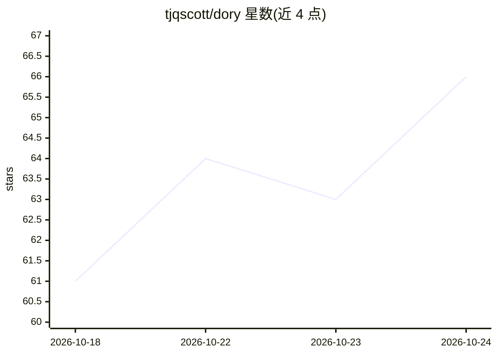

# tjqscott/dory

⭐ 67 · Python · MIT · 推送 2026-10-05 · [GitHub](https://github.com/tjqscott/dory) · 个人维护

**把会话记忆存到本地的 LLM 上下文管理工具**

面向使用托管聊天界面与编码 agent 的用户，提供两个版本：浏览器版是单个 HTML 文件，把项目记忆保存在用户拥有的文件中，通过粘贴上下文开启新会话、以 append-only 帖子回收模型输出，页面不发网络请求；代码版以 Claude Code 插件形式安装，在仓库内维护 wiki/（索引、tried.md 记录假设与结论、tickets.md 任务板），由 hooks 在会话开始加载指令、结束时 lint wiki。支持 Codex（AGENTS.md）与本地模型，/dory:loop 支持长时运行并在限额阈值切换 CPU 任务。

## 筛选速览

| 维度 | 判定 | 备注 |
|---|---|---|
| AI 角色 | `ai-ecosystem` | LLM/agent 周边工具 |
| 许可风险 | `permissive` | MIT |
| 部署形态 | `None` |  |
| 模型依赖 | locked-api |  |
| 硬件要求 | — | 无带数字的原话,不猜 |
| 安装摩擦 | `low` | 无编译、无系统依赖或容器化 |
| 成熟度 | — | 结构信号不足 |

## 能力要点

- 浏览器版为单 HTML 文件，记忆存于本地文件，页面无网络调用
- append-only 帖子机制，replaces 可覆盖旧帖且不丢失记录
- Claude Code 插件版以 wiki/ + hooks 维护结构化项目记忆并 lint
- /dory:loop 长时运行：90% 限额停止重模型任务，95% 启动 CPU 任务并写交接

## 适用场景

- 在 Claude/ChatGPT 网页聊天中跨会话保留项目记忆
- 让 Claude Code 在仓库内维护 findings ledger 与任务板
- Codex 项目通过 AGENTS.md 复用同一套指令与记忆结构

## 场景标签

`Agent 记忆` · 领域:Agent 开发

## 证据(README 行号)

> L5:  Stateless context management for LLM sessions.
> L12: Every new chat starts blind. Long threads drain quotas and dilute context, and closing the tab loses the project. D
> L18: |**For**|any hosted chat: Claude, ChatGPT, Gemini, local models|Claude Code (plugin) and Codex (`AGENTS.md`)|

## 星数曲线

2026-10-18 61 → 2026-10-24 66（+5）

---
*卡片 v1 · prompt 1.4 · 生成 2026-10-24 · 置信度 high · 依据 README sha `a5e876a6e23a` · [字段定义](../../DATASET.md)*
