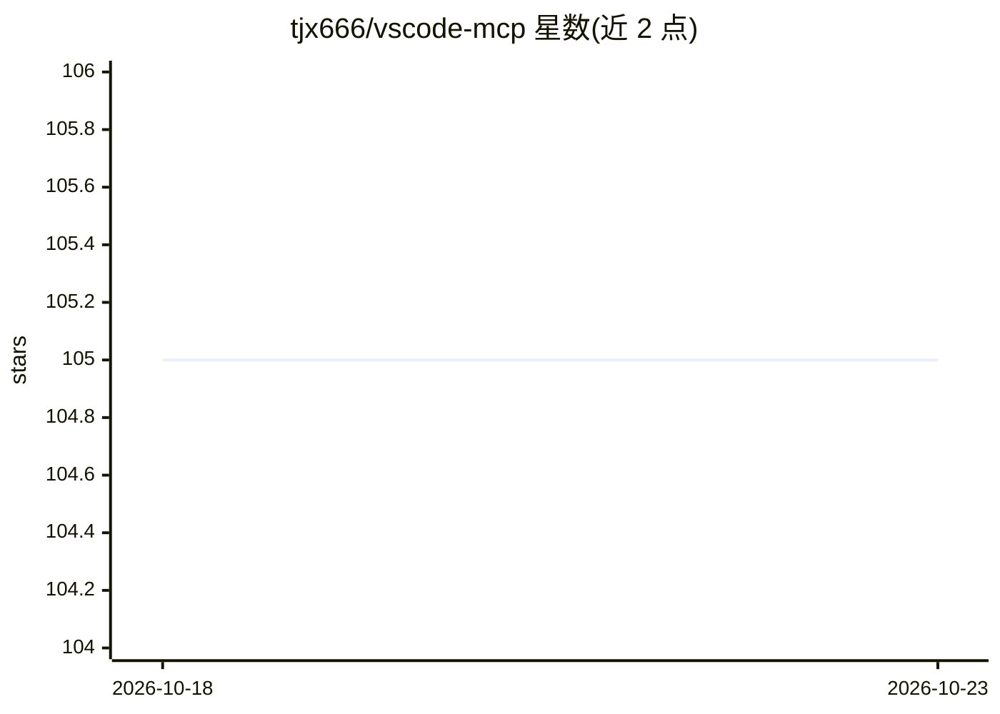

# tjx666/vscode-mcp

⭐ 105 · TypeScript · NOASSERTION · 推送 2026-08-06 · [GitHub](https://github.com/tjx666/vscode-mcp) · 个人维护

**让 AI 编程代理实时获取 VSCode LSP 诊断与代码导航的 MCP server**

由 VSCode 扩展（VSCode MCP Bridge）与 MCP Server/CLI 两部分组成的 monorepo：MCP server 或 CLI 通过 per-workspace Unix socket 与 VSCode 扩展通信，把 VSCode 语言服务器的实时信息（诊断、定义、hover、签名、类型、引用）以 MCP 工具或 CLI 子命令形式提供给 AI 编程代理（Cursor、Claude Code、Codex、Gemini CLI 等），替代耗时的 tsc/eslint/build 校验；还提供符号跨文件重命名、文件打开、execute_command 等工具，支持白/黑名单工具过滤。采用 Anti 996 License。

## 筛选速览

| 维度 | 判定 | 备注 |
|---|---|---|
| AI 角色 | `ai-ecosystem` | LLM/agent 周边工具 |
| 许可风险 | `none` | NOASSERTION |
| 部署形态 | `library` | 以包/库形式分发 |
| 模型依赖 | locked-api |  |
| 硬件要求 | — | 无带数字的原话,不猜 |
| 安装摩擦 | `low` | 无编译、无系统依赖或容器化 |
| 成熟度 | — | 结构信号不足 |

## 能力要点

- 通过 MCP 协议暴露 9 个工具（get-diagnostics、get-symbol-lsp-info、get-references、rename_symbol 等）
- 复用 VSCode LSP 实时数据，替代缓慢的 tsc/eslint/build 命令
- 同功能 CLI（@vscode-mcp/vscode-mcp-cli），无需注册 MCP 即可用 shell 调用
- 按工作区 Unix socket 通信，支持多 VSCode 窗口定向

## 适用场景

- AI 编程代理修改代码后快速获取实时诊断而非运行 tsc/eslint
- 让 agent 在大项目中查询符号定义、类型与引用上下文
- 在不配置 MCP 的环境中用 CLI 子命令获取相同能力

## 场景标签

 · 领域:开发工具/AI 代理基础设施

## 证据(README 行号)

> L18: VSCode MCP is a comprehensive monorepo solution that enables MCP (Model Context Protocol) clients to access rich VS
> L30: These commands run slowly in large projects, severely impacting AI development efficiency. VSCode MCP Bridge provid
> L182: 1. **VSCode Extension**: Runs in your VSCode instance and provides access to LSP data

## 星数曲线

2026-10-18 105 → 2026-10-23 105（+0）

---
*卡片 v1 · prompt 1.4 · 生成 2026-10-23 · 置信度 high · 依据 README sha `b6d59561193d` · [字段定义](../../DATASET.md)*
