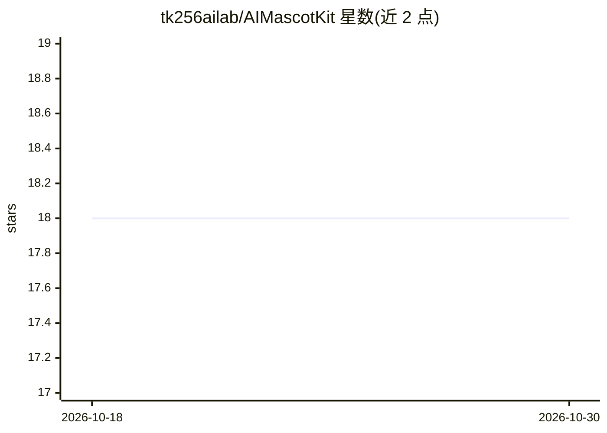

# tk256ailab/AIMascotKit

⭐ 18 · HTML · MIT · 推送 2025-12-11 · [GitHub](https://github.com/tk256ailab/AIMascotKit) · 个人维护

**用 VRM 模型搭建 AI 桌面宠物的工具包（v0.1-pre）**

面向希望创建 AI 桌面吉祥物的用户的工具包：以 Three.js 渲染 3D VRM 角色，通过 Google Gemini 生成对话，实时检测 11 种情绪并联动表情、VRMA 动画与口型同步；集成 AivisSpeech 语音合成、实时语音识别、日英双语字幕，以及 macOS 专用的屏幕截图解析实现上下文理解。任务功能覆盖 Spotify 播放控制、天气、新闻、Wikipedia、arXiv 检索与定时器。运行需 Python 3.8+、GEMINI_API_KEY（必填）与预先启动的 AivisSpeech；屏幕解析为 macOS 专用，Linux/Windows 部分功能受限（验证中）。版本标注 v0.1-pre。

## 筛选速览

| 维度 | 判定 | 备注 |
|---|---|---|
| AI 角色 | `ai-native` | 本体是模型或模型工具 |
| 许可风险 | `permissive` | MIT |
| 部署形态 | `None` |  |
| 模型依赖 | — | README 未给出锁定关系 |
| 硬件要求 | — | 无带数字的原话,不猜 |
| 安装摩擦 | `low` | 无编译、无系统依赖或容器化 |
| 成熟度 | `idea` | |

## 能力要点

- VRM 3D 角色显示与 11 种情绪联动的表情/VRMA 动画
- Gemini 驱动对话、语音识别与 AivisSpeech 语音合成、口型同步
- macOS 屏幕截图解析用于对话上下文理解
- Spotify/天气/新闻/Wikipedia/arXiv 等任务执行功能

## 适用场景

- 做一个常驻桌面、可对话会表达情绪的 AI 桌宠
- 用语音与 VRM 角色互动并获得字幕与语音回应
- 通过自定义 VRM 模型与系统提示词打造个人 AI 吉祥物

## 场景标签

`语音 Agent` `AI 助手` · 领域:对话与助手

## 证据(README 行号)

> L5: AIMascotKitは、VRMモデルを使用したAIキャラクターのデスクトップマスコットを誰でも簡単に作成できるツールキットです。リアルタイムで感情表現、音声合成、スクリーンショット解析をはじめ、Spotifyなどの外部サービスとも
> L21: - **Google Gemini統合**: 高性能な会話生成とマルチモーダル対応
> L28: - **音声合成**: AivisSpeech APIを使用した自然な音声生成

## 星数曲线

2026-10-18 18 → 2026-10-30 18（+0）

---
*卡片 v1 · prompt 1.4 · 生成 2026-10-29 · 置信度 high · 依据 README sha `affe37086cd1` · [字段定义](../../DATASET.md)*
