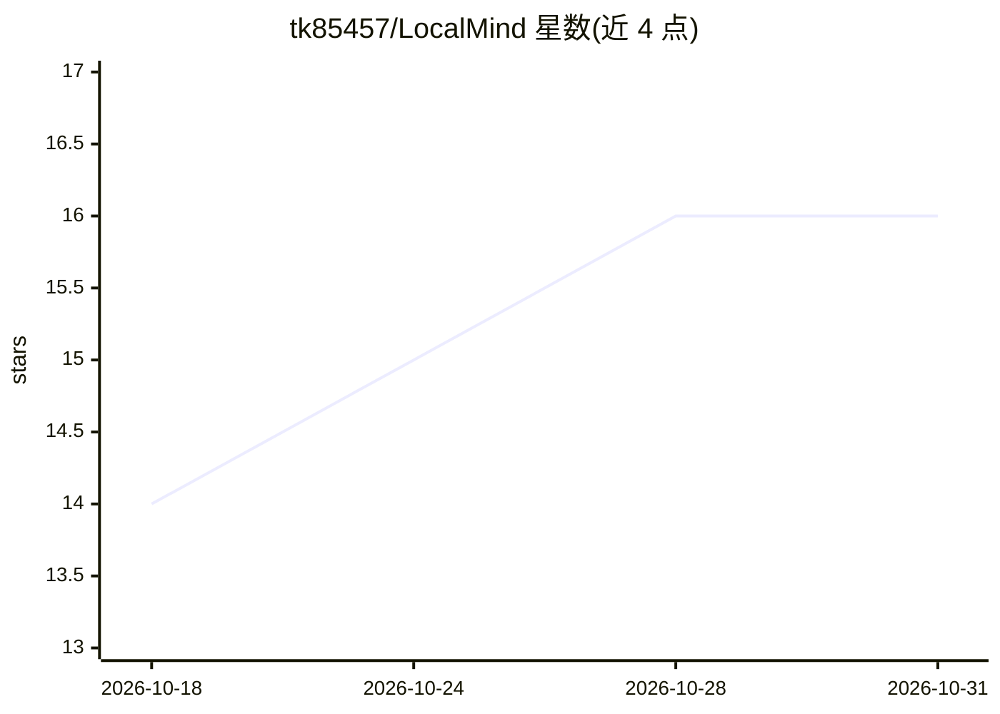

# tk85457/LocalMind

⭐ 16 · C++ · MIT · 推送 2026-10-15 · [GitHub](https://github.com/tk85457/LocalMind) · [官网](https://github.com/tk85457/LocalMind/releases/latest) · 个人维护

**Android 本地 LLM 聊天应用：离线运行 GGUF 模型**

基于 Kotlin、Jetpack Compose 与 Material 3 的 Android 应用，通过 JNI/NDK 集成 llama.cpp，在手机端离线运行 GGUF 量化模型完成对话推理。支持从 Hugging Face 浏览与下载模型（Llama 3、Mistral、Phi-3、Gemma、Qwen 等），提供温度/Top-P/Top-K 等推理参数调节、GPU 层卸载、tokens/s 与 TTFT 监控、PDF 文档 RAG 问答、聊天记录搜索与生物识别锁。数据全部本地存储，无网络请求。要求 Android 8.0+ 与 arm64-v8a，1B–3B 模型需 4GB+ RAM。提供预编译 APK 或源码构建（需 Android Studio、JDK 17+、NDK 26）。

## 筛选速览

| 维度 | 判定 | 备注 |
|---|---|---|
| AI 角色 | `ai-native` | 本体是模型或模型工具 |
| 许可风险 | `permissive` | MIT |
| 部署形态 | `desktop` | 安装包/桌面程序 |
| 模型依赖 | local-ok | 支持本地模型 |
| 硬件要求 | — | 无带数字的原话,不猜 |
| 安装摩擦 | `medium` | 含编译或系统依赖之一 |
| 成熟度 | — | 结构信号不足 |

## 能力要点

- llama.cpp（JNI/NDK）驱动的端上 GGUF 模型推理，无需 API key
- Hugging Face 模型浏览/下载/切换，支持多种量化格式与模型家族
- 温度/Top-P/Top-K/重复惩罚等推理参数与 GPU 层卸载
- PDF 解析的本地 RAG 文档问答与生物识别锁

## 适用场景

- 在没有网络或注重隐私的场景下用手机本地跑 LLM 聊天
- 下载并切换多种 GGUF 量化模型进行端上对话
- 对本地 PDF 文档提问并获得基于内容的回答

## 场景标签

`聊天机器人` `文档问答` · 领域:对话与助手

## 证据(README 行号)

> L19:  Run powerful Large Language Models (LLMs) entirely on your Android phone — no cloud servers, no API keys, no mon
> L31: **LocalMind** is a privacy-first, open-source Android application that brings the power of Large Language Models di
> L123: |**AI Engine**|llama.cpp (JNI/NDK)|On-device LLM inference|

## 星数曲线

2026-10-18 14 → 2026-10-31 16（+2）

---
*卡片 v1 · prompt 1.4 · 生成 2026-10-30 · 置信度 high · 依据 README sha `c7664bf70462` · [字段定义](../../DATASET.md)*
