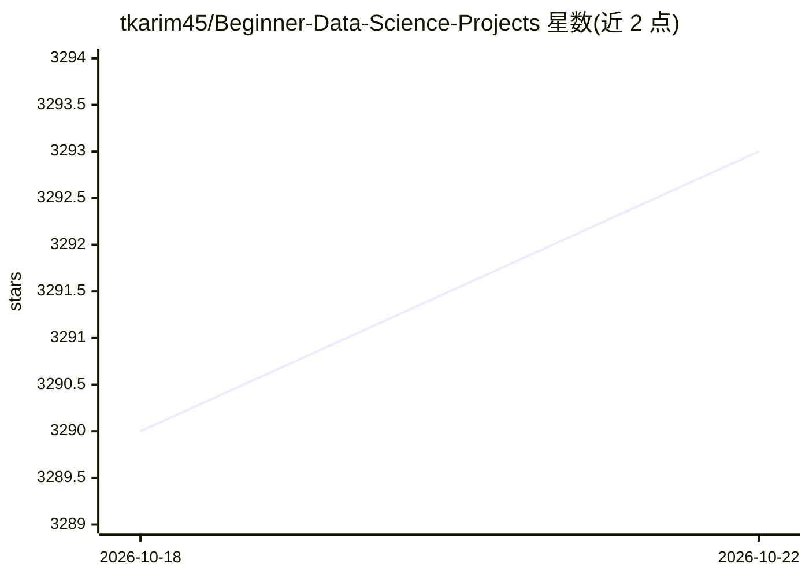

# tkarim45/Beginner-Data-Science-Projects

⭐ 3,293 · Jupyter Notebook · MIT · 推送 2026-07-29 · [GitHub](https://github.com/tkarim45/Beginner-Data-Science-Projects) · 个人维护

**面向初学者的数据科学实战项目集（115 个 Jupyter 项目）**

面向数据科学入门者（学生、转行者、自学者）的实战项目合集：收录 115 个独立 Jupyter Notebook 项目，配真实数据集与可运行代码，按分类（Classification/NLP/Computer Vision/Regression/Time Series 等 11 类）与四级难度组织，内容覆盖数据清洗、EDA、机器学习、深度学习（CNN、迁移学习）与计算机视觉。运行需 Python 3.9+ 与 Jupyter，核心库通过 pip 安装，各项目带独立 requirements.txt，git clone 后即可运行。

## 筛选速览

| 维度 | 判定 | 备注 |
|---|---|---|
| AI 角色 | `ai-knowledge` | 知识聚合/清单类 |
| 许可风险 | `permissive` | MIT |
| 部署形态 | `library` | 以包/库形式分发 |
| 模型依赖 | — | README 未给出锁定关系 |
| 硬件要求 | — | 无带数字的原话,不猜 |
| 安装摩擦 | `low` | 无编译、无系统依赖或容器化 |
| 成熟度 | — | 结构信号不足 |

## 能力要点

- 115 个独立 Jupyter Notebook 项目，配真实数据集与可运行代码
- 按 11 个类别与 4 级难度（Beginner 到 Advanced）组织学习路径
- 覆盖数据清洗、EDA、机器学习、深度学习、NLP 与计算机视觉
- 每个项目附带独立 requirements.txt 精确依赖

## 适用场景

- 数据科学入门者通过动手项目学习完整 ML 工作流
- 转行者或学生按难度递进练习分类、回归、NLP、CV 等任务
- 教学场景中直接取用带数据集的现成练习项目

## 场景标签

`教程课程` · 领域:学习与行业

## 证据(README 行号)

> L11:  A curated collection of beginner-friendly data science projects with real datasets, clear explanations, and workin
> L17: This repository is designed for **anyone getting started with data science** -- students, career switchers, and sel

## 星数曲线

2026-10-18 3,290 → 2026-10-22 3,293（+3）

---
*卡片 v1 · prompt 1.4 · 生成 2026-10-20 · 置信度 mid · 依据 README sha `f0194753a149` · [字段定义](../../DATASET.md)*
