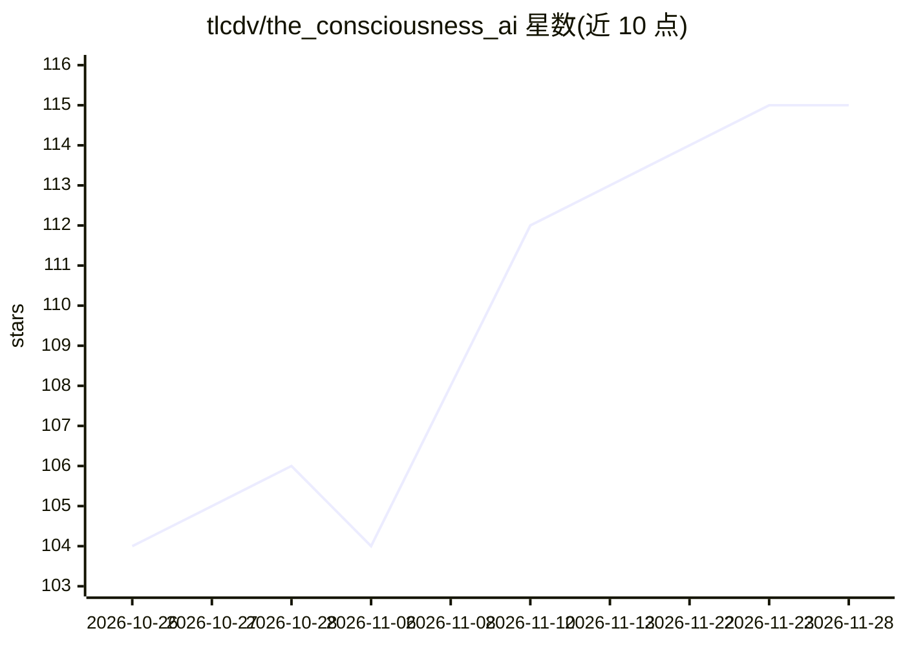

# tlcdv/the_consciousness_ai

⭐ 115 · Python · NOASSERTION · 推送 2026-11-27 · [GitHub](https://github.com/tlcdv/the_consciousness_ai) · [官网](https://theconsciousness.ai) · 个人维护

**研究合成意识涌现的开源实验框架（Python）**

开源研究框架，通过模拟智能体研究合成觉知的涌现，核心假设是意识源于在复杂环境中维持稳定性的涌现解。架构包含多感官空间整合层（视觉/听觉/体感）、Kuramoto 振荡绑定机制、全局工作空间竞争广播、PAD 情绪调节与稳态驱动等模块，基于 Feinberg & Mallatt 的神经演化意识理论设计。README 报告了多个尚未验证或已失败的子目标，并记录了当前实现的已知限制。

## 筛选速览

| 维度 | 判定 | 备注 |
|---|---|---|
| AI 角色 | `ai-native` | 本体是模型或模型工具 |
| 许可风险 | `none` | NOASSERTION |
| 部署形态 | `library` | 以包/库形式分发 |
| 模型依赖 | — | README 未给出锁定关系 |
| 硬件要求 | — | 无带数字的原话,不猜 |
| 安装摩擦 | `low` | 无编译、无系统依赖或容器化 |
| 成熟度 | `idea` | |

## 能力要点

- 多感官整合层：视觉卷积栈、Gammatone 听觉管线、体感通道在共同坐标网格融合
- 两种可选绑定机制：AKOrN（默认）与 KomplexNet，训练时切换
- 全局工作空间实现 sigmoid 点火、循环回响与重入处理
- 公开记录失败实验与当前代码的实测限制（如 Dominance 恒为 0.0）

## 适用场景

- 研究意识理论的功能主义模拟实验
- 复现或扩展全局工作空间/振荡绑定架构
- 开展多感官整合与情绪调节机制的消融实验

## 场景标签

`科研工具` · 领域:学习与行业

## 证据(README 行号)

> L21: **The Consciousness AI** is a research framework investigating the emergence of synthetic awareness. Unlike traditi
> L49: ## Architecture

## 星数曲线

2026-10-26 104 → 2026-11-28 115（+11）

---
*卡片 v1 · prompt 1.4 · 生成 2026-11-28 · 置信度 mid · 依据 README sha `bfc41fc886a1` · [字段定义](../../DATASET.md)*
