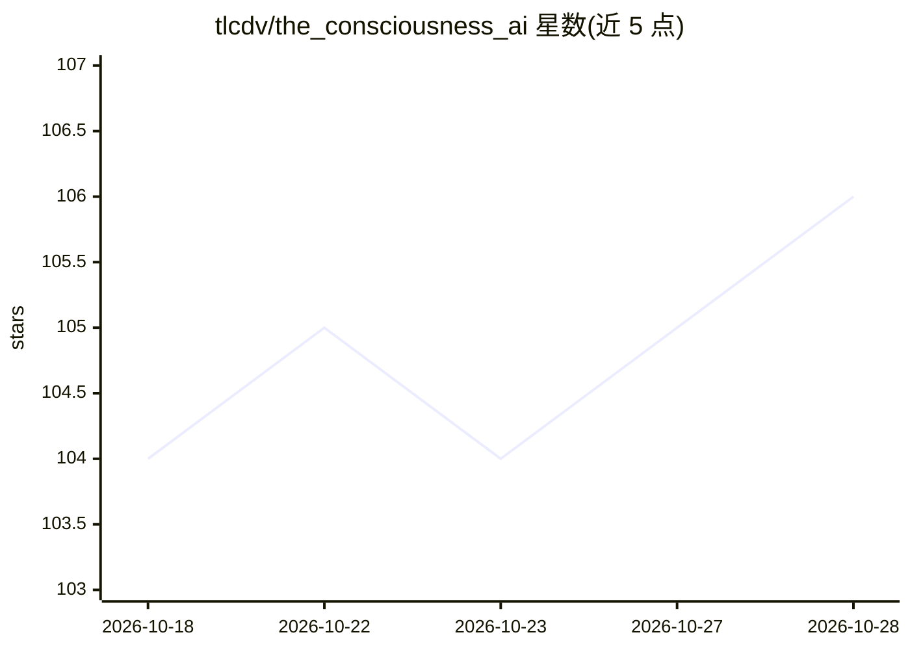

# tlcdv/the_consciousness_ai

⭐ 106 · Python · NOASSERTION · 推送 2026-10-27 · [GitHub](https://github.com/tlcdv/the_consciousness_ai) · [官网](https://theconsciousness.ai) · 个人维护

**意识模拟研究框架：通过内部稳态与整合信息生成行为**

开源研究框架，研究合成意识的涌现：不直接模仿智能输出，而是让行为由情绪稳态（PAD 模型、内稳态驱动）与整合信息（Phi、全局神经工作空间）的内部过程产生。架构含多感觉感官顶盖（视觉/听觉/体感）、Kuramoto 振荡绑定（AKOrN/KomplexNet 二选一）、GNW 瓶颈广播、情感调制核、具身自我模型与强化学习核心。听觉管线用 Gammatone 滤波组与耳蜗模型，视觉 DINOv2 可选（默认关）。多处标注目标仍处验证/失败记录状态。面向意识研究与认知科学方向的研究者。

## 筛选速览

| 维度 | 判定 | 备注 |
|---|---|---|
| AI 角色 | `ai-native` | 本体是模型或模型工具 |
| 许可风险 | `none` | NOASSERTION |
| 部署形态 | `library` | 以包/库形式分发 |
| 模型依赖 | — | README 未给出锁定关系 |
| 硬件要求 | — | 无带数字的原话,不猜 |
| 安装摩擦 | `low` | 无编译、无系统依赖或容器化 |
| 成熟度 | `idea` | |

## 能力要点

- GNW 全局工作空间广播 + Phi 整合信息度量 + 因果涌现 CE 2.0 诊断
- 双绑定机制可选：AKOrN（ICLR 2025 派生）与 KomplexNet（Muzellec 2025 派生）
- 生物 grounded 听觉管线：Gammatone 滤波组、内毛细胞模型、ITD/ILD 双耳定位
- Brian2 脉冲网络离线验证振荡参数（Pearson 相关比较）

## 适用场景

- 研究人工意识/合成觉知的涌现机制
- 复现与对比振荡绑定机制（AKOrN vs KomplexNet）
- 在 Dark Room/Navigation/DMTCS/WCST 环境中训练与度量 agent
- 基于 Feinberg & Mallatt 神经演化理论做认知架构实验

## 场景标签

`强化学习` `科研工具` · 领域:学习与行业

## 证据(README 行号)

> L17: **The Consciousness AI** is a research framework investigating the emergence of synthetic awareness. Unlike traditi
> L39: The system is built on a biologically grounded architecture informed by Feinberg & Mallatt's neuroevolutionary theo
> L70: * **Global Neuronal Workspace (GNW):** A central information bottleneck where distinct sensory streams compete for 

## 星数曲线

2026-10-18 104 → 2026-10-28 106（+2）

---
*卡片 v1 · prompt 1.4 · 生成 2026-10-23 · 置信度 high · 依据 README sha `cd015b869e73` · [字段定义](../../DATASET.md)*
