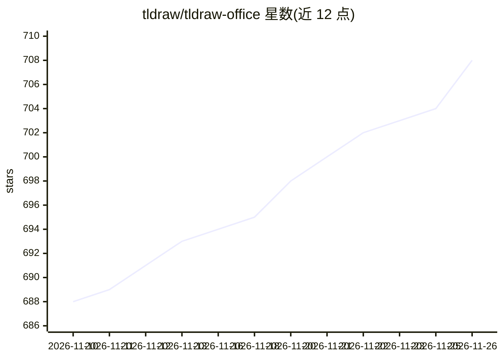

# tldraw/tldraw-office

⭐ 708 · 推送 2026-11-12 · [GitHub](https://github.com/tldraw/tldraw-office) · [官网](https://offline.tldraw.com) · 组织维护

**离线本地白板桌面应用，可接入编码 agent 操作画布**

tldraw 官方推出的桌面白板应用：在 tldraw 无限画布上绘画、制图、添加文本与媒体，无账号与服务器，可离线使用，文档保存为可携带的 .tldraw 文件并跨平台工作，支持打开与导出旧版 .tldr 文件。AI 部分为“自带 agent”机制：可与 Codex、Claude Code、Pi、OpenCode 等编码 agent 配合，agent 能读取与编辑画布并创建内嵌文档脚本；文档明确提示脚本在打开文件时可运行，仅应授予可信 agent 与可信文件访问权。应用以安装包分发，非开源（保留所有权利）。

## 筛选速览

| 维度 | 判定 | 备注 |
|---|---|---|
| AI 角色 | `ai-enhanced` | 去掉 AI 部分产品仍成立 |
| 许可风险 | `none` | — |
| 部署形态 | `None` |  |
| 模型依赖 | — | README 未给出锁定关系 |
| 硬件要求 | — | 无带数字的原话,不猜 |
| 安装摩擦 | `low` | 无编译、无系统依赖或容器化 |
| 成熟度 | — | 结构信号不足 |

## 能力要点

- 无账号、无服务器，支持完全离线使用
- 文档保存为可携带的 .tldraw 文件，跨 macOS/Windows/Linux
- 可接入 Codex、Claude Code、Pi、OpenCode 等编码 agent 读写画布
- agent 可创建内嵌文档脚本为文件添加新行为

## 适用场景

- 在本地画布上做绘图、图表与白板记录且文件完全自持
- 让编码 agent 检查和修改打开中的画布文档
- 离线环境下进行画布创作与文档备份

## 场景标签

 · 领域:桌面生产力/白板工具

## 证据(README 行号)

> L7: A local whiteboard for you and your agents.
> L9: tldraw office is a desktop application for drawing, diagramming, whiteboarding, and more on tldraw's infinite canvas
> L51: tldraw office can work with coding agents such as Codex, Claude Code, Pi, and OpenCode. An agent can inspect an ope

## 星数曲线

2026-11-10 688 → 2026-11-26 708（+20）

---
*卡片 v1 · prompt 1.4 · 生成 2026-11-17 · 置信度 high · 依据 README sha `bcab9df42927` · [字段定义](../../DATASET.md)*
