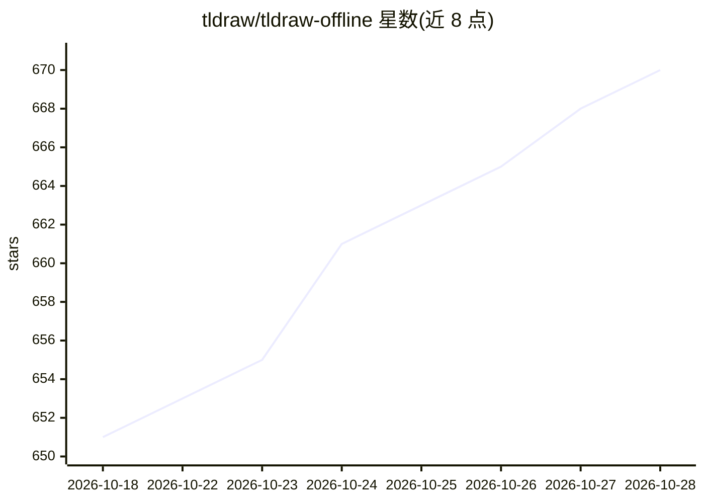

# tldraw/tldraw-offline

⭐ 670 · 推送 2026-10-23 · [GitHub](https://github.com/tldraw/tldraw-offline) · [官网](https://offline.tldraw.com) · 组织维护

**本地离线的 tldraw 白板桌面应用，支持 AI agent 读写画布**

基于 tldraw 无限画布的桌面应用，提供绘图、图表、白板等创作功能，无账户与服务器，可离线运行。文档以可移植的 .tldraw 文件保存，支持打开/导出旧版 .tldr 文件，自动保留工作副本以恢复意外退出前的工作。支持接入编码类 agent（如 Codex、Claude Code、Pi、OpenCode）读取与编辑画布并创建文档脚本；README 提示脚本可在文件打开时运行，仅应对信任的 agent 与文件授权。提供 macOS/Windows/Linux 安装包与 Homebrew 安装，但注明本应用非开源、保留所有权利。

## 筛选速览

| 维度 | 判定 | 备注 |
|---|---|---|
| AI 角色 | `ai-enhanced` | 去掉 AI 部分产品仍成立 |
| 许可风险 | `none` | — |
| 部署形态 | `None` |  |
| 模型依赖 | — | README 未给出锁定关系 |
| 硬件要求 | — | 无带数字的原话,不猜 |
| 安装摩擦 | `low` | 无编译、无系统依赖或容器化 |
| 成熟度 | — | 结构信号不足 |

## 能力要点

- 完全离线运行，无账户与服务器，文档保存为可移植 .tldraw 文件
- 可与编码 agent（Codex、Claude Code、Pi、OpenCode）协作读写画布
- 支持创建嵌入 .tldraw 文件的可复用文档脚本
- 意外退出后自动恢复未保存工作

## 适用场景

- 本地白板绘图与图表制作，不依赖网络与账户
- 让编码 agent 检查和修改画布内容
- 以可移植文件形式私有保存、备份或分享画布文档

## 场景标签

 · 领域:创意/生产力工具

## 证据(README 行号)

> L9: tldraw offline is a desktop application for drawing, diagramming, whiteboarding, and more on tldraw's infinite canva
> L51: tldraw offline can work with coding agents such as Codex, Claude Code, Pi, and OpenCode. An agent can inspect an op

## 星数曲线

2026-10-18 651 → 2026-10-28 670（+19）

---
*卡片 v1 · prompt 1.4 · 生成 2026-10-21 · 置信度 high · 依据 README sha `c2be4f10512f` · [字段定义](../../DATASET.md)*
