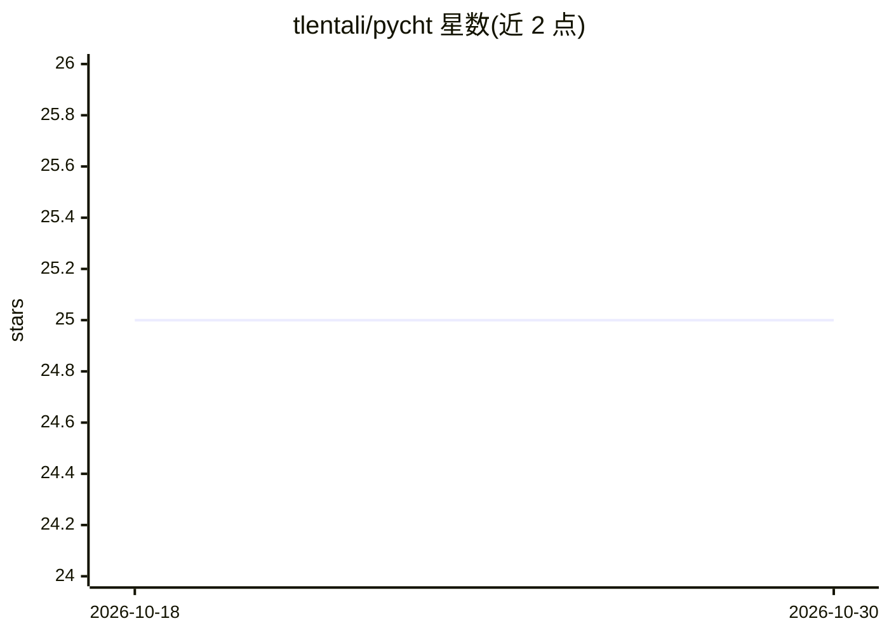

# tlentali/pycht

⭐ 25 · Python · MIT · 推送 2026-04-14 · [GitHub](https://github.com/tlentali/pycht) · [官网](https://tlentali.github.io/pycht/) · 个人维护

**用聚类把照片转成多色喷漆模板的 Python 库**

pycht 读取输入图片，用 Scikit-Learn 的 K-Means 对像素按颜色聚类，将每个像素替换为所属簇质心的颜色，生成海报风格的简化图；随后为每种颜色生成一个透明 PNG 模板层，用于实物喷漆分层创作。以 Python 库（需 3.12+）与 CLI 两种形式提供，Linux/macOS/Windows 均有 wheel，输出为聚类图与逐色模板 PNG。

## 筛选速览

| 维度 | 判定 | 备注 |
|---|---|---|
| AI 角色 | `ai-native` | 本体是模型或模型工具 |
| 许可风险 | `permissive` | MIT |
| 部署形态 | `library` | 以包/库形式分发 |
| 模型依赖 | — | README 未给出锁定关系 |
| 硬件要求 | — | 无带数字的原话,不猜 |
| 安装摩擦 | `low` | 无编译、无系统依赖或容器化 |
| 成熟度 | — | 结构信号不足 |

## 能力要点

- K-Means 聚类提取 N 个主色并映射像素
- 逐色生成透明 PNG 模板层
- 提供 Python API 与命令行两种使用方式
- pip 安装，三平台均有 wheel

## 适用场景

- 把照片转成多色模板用于街头喷漆或丝网印刷
- 生成海报风格的简化版图片
- 为数字插画制作分层色版

## 场景标签

`图像视频处理` · 领域:感知与多模态

## 证据(README 行号)

> L71:  Then comes the science. Using Scikit-Learn’s `kmeans`, we ask: *“Hey, what are the `N` most dominant colors in thi
> L23: >>> pycht.stencil('cat.jpg', 5)

## 星数曲线

2026-10-18 25 → 2026-10-30 25（+0）

---
*卡片 v1 · prompt 1.4 · 生成 2026-10-26 · 置信度 high · 依据 README sha `3a76f8658e50` · [字段定义](../../DATASET.md)*
