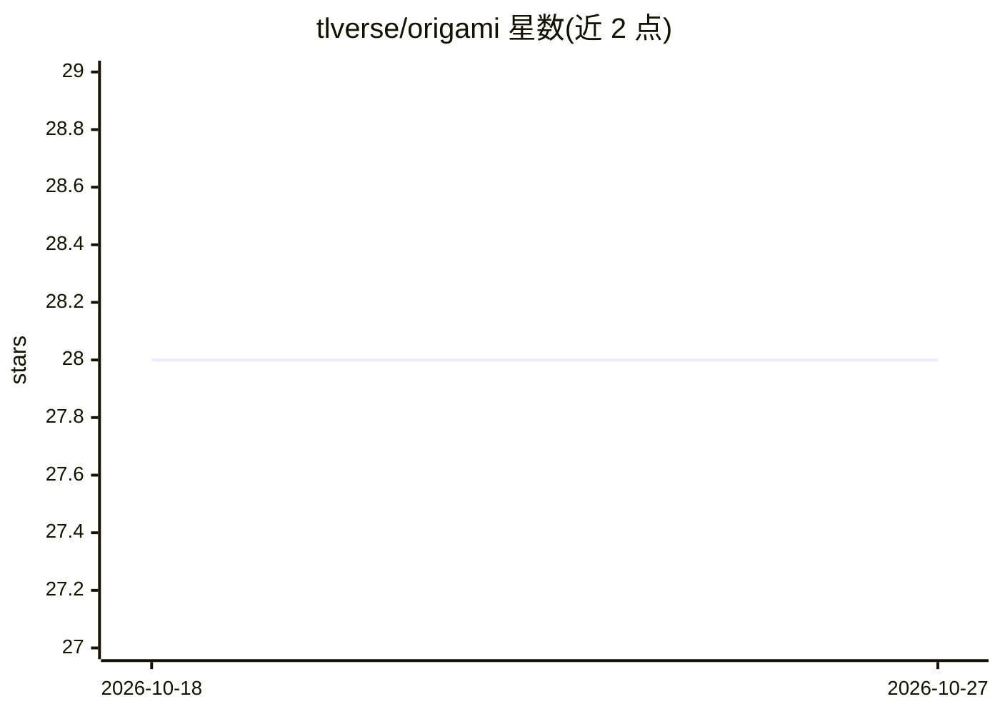

# tlverse/origami

⭐ 28 · R · GPL-3.0 · 推送 2026-05-23 · [GitHub](https://github.com/tlverse/origami) · [官网](https://tlverse.org/origami) · 组织维护

**R 语言通用交叉验证框架：把任意函数套上 CV 方案**

origami 是一个 R 包，提供将交叉验证方案应用于任意函数的通用框架：用户编写 cv_fun 包装函数后，由 cross_validate 按折划分执行并汇总结果，允许返回任意列表结构以适应不同的交叉验证应用场景。面向需要在 R 中做交叉验证估计（如统计学习、目标定向推断场景）的开发者与科研用户。通过 CRAN 或 GitHub（devtools）安装，附有入门 vignette，发表过 JOSS 论文（2018），GPL v3 许可。

## 筛选速览

| 维度 | 判定 | 备注 |
|---|---|---|
| AI 角色 | `ai-ecosystem` | LLM/agent 周边工具 |
| 许可风险 | `viral` | GPL-3.0 |
| 部署形态 | `None` |  |
| 模型依赖 | — | README 未给出锁定关系 |
| 硬件要求 | — | 无带数字的原话,不猜 |
| 安装摩擦 | `low` | 无编译、无系统依赖或容器化 |
| 成熟度 | — | 结构信号不足 |

## 能力要点

- 将任意交叉验证方案应用于任意函数的通用框架
- cv_fun 包装器 + cross_validate 执行的机制
- 结果允许为任意列表，适应多种 CV 应用

## 适用场景

- 在 R 中为自定义统计函数做交叉验证估计
- 为机器学习/统计流程构建可复用的 CV 折划分
- 跟随 vignette 学习广义交叉验证写法

## 场景标签

 · 领域:统计学习/模型评估工具

## 证据(README 行号)

> L29: The `origami` R package provides a general framework for the application
> L31: arbitrary lists of results, `origami` accommodates a range of

## 星数曲线

2026-10-18 28 → 2026-10-27 28（+0）

---
*卡片 v1 · prompt 1.4 · 生成 2026-10-26 · 置信度 high · 依据 README sha `c91322d717a1` · [字段定义](../../DATASET.md)*
