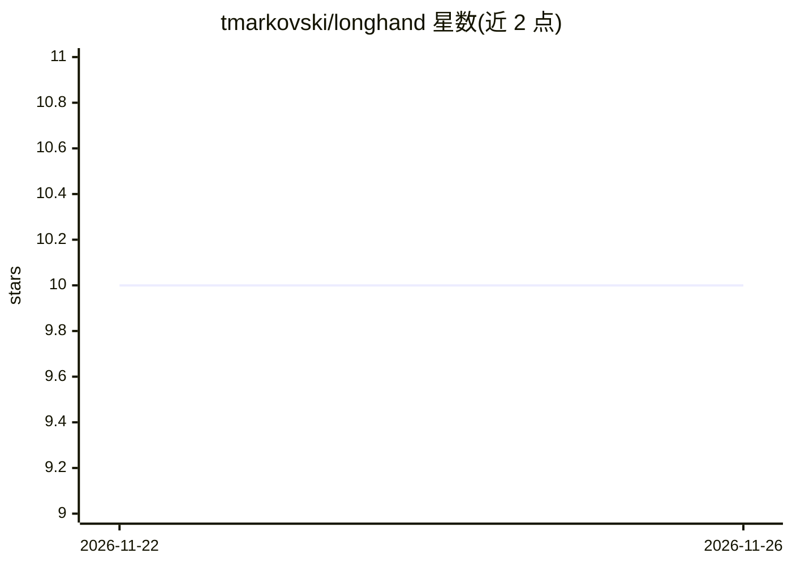

# tmarkovski/longhand

⭐ 10 · TypeScript · Apache-2.0 · 推送 2026-11-03 · [GitHub](https://github.com/tmarkovski/longhand) · [官网](http://trylonghand.com) · 个人维护

**网页与移动端的神经网络手写生成 SDK**

在客户端运行两套手写生成引擎的 SDK 与演示站点：ink-graves 移植 Graves (2013) 手写 RNN（约 3.6M 参数），ink-calligrapher 移植 calligrapher.ai 浏览器引擎，均仅推理、权重随包分发；引擎输出笔画中间表示，由自研渲染层生成动画 SVG、GIF、视频与笔画 JSON。提供 TypeScript npm 包、SwiftPM 包（Apple 平台）与纯 Kotlin 模块（Android/JVM），仓库可直接以 git 依赖消费；生成完全在客户端完成，无后端服务。开发需 Node 24+、pnpm 与 uv（MLX）用于生成黄金测试向量。

## 筛选速览

| 维度 | 判定 | 备注 |
|---|---|---|
| AI 角色 | `ai-native` | 本体是模型或模型工具 |
| 许可风险 | `permissive` | Apache-2.0 |
| 部署形态 | `library` | 以包/库形式分发 |
| 模型依赖 | — | README 未给出锁定关系 |
| 硬件要求 | — | 无带数字的原话,不猜 |
| 安装摩擦 | `low` | 无编译、无系统依赖或容器化 |
| 成熟度 | — | 结构信号不足 |

## 能力要点

- 两套客户端推理手写引擎（Graves RNN 移植 + calligrapher.ai 移植），无生成后端
- 导出动画 SVG、GIF、视频与原始笔画 JSON
- 跨平台 SDK：npm、SwiftPM、JitPack/Gradle 多端接入，权重随包内嵌
- 基于 MLX 参考实现的黄金测试向量保证各移植版本一致性

## 适用场景

- 在网页或移动应用中嵌入文本转手写动画
- 为笔式绘图仪生成手写笔画数据
- 将生成的手写导出为动画 SVG/GIF/视频用于内容创作

## 场景标签

`图像生成` · 领域:内容生成

## 证据(README 行号)

> L4: a living vector file. Every stroke is generated on the client; there is no
> L13: Two handwriting engines run client-side. Both are inference-only ports of
> L34: `ink-swift` brings all of it to Apple platforms as a SwiftPM package. It is

## 星数曲线

2026-11-22 10 → 2026-11-26 10（+0）

---
*卡片 v1 · prompt 1.4 · 生成 2026-11-22 · 置信度 high · 依据 README sha `8af06170907e` · [字段定义](../../DATASET.md)*
