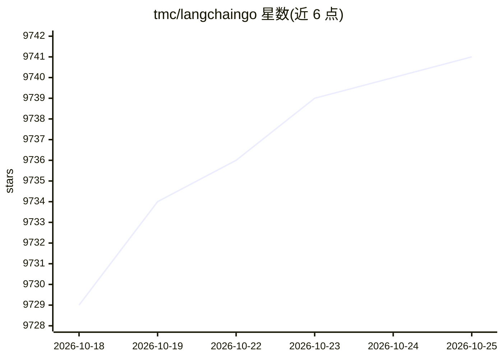

# tmc/langchaingo

⭐ 9,741 · Go · MIT · 推送 2026-10-22 · [GitHub](https://github.com/tmc/langchaingo) · [官网](https://tmc.github.io/langchaingo/) · 组织维护

**LangChain 的 Go 语言实现，用 Go 构建 LLM 应用**

LangChain 的 Go 语言移植实现，面向 Go 开发者提供以可组合方式构建 LLM 应用的框架能力。README 未展开具体模块清单，提供文档站点、go.dev API 参考、examples 目录示例与 Dev Containers 开发环境入口，并链接多篇使用文章（Gemini、Ollama、ChatGPT 克隆等主题）。本体为框架库而非终端应用，用户基于它编写 Go 程序接入各类模型。

## 筛选速览

| 维度 | 判定 | 备注 |
|---|---|---|
| AI 角色 | `ai-ecosystem` | LLM/agent 周边工具 |
| 许可风险 | `permissive` | MIT |
| 部署形态 | `None` |  |
| 模型依赖 | — | README 未给出锁定关系 |
| 硬件要求 | — | 无带数字的原话,不猜 |
| 安装摩擦 | `low` | 无编译、无系统依赖或容器化 |
| 成熟度 | — | 结构信号不足 |

## 能力要点

- LangChain 框架的 Go 语言实现
- 以可组合（composability）方式构建 LLM 应用
- 提供 examples 目录示例与文档站点/API 参考
- 支持 Dev Containers 开发环境

## 适用场景

- 用 Go 编写 LLM 驱动的应用程序
- 参考示例学习链式调用与模型接入
- 在已有 Go 技术栈中引入 LangChain 风格的 LLM 抽象

## 场景标签

`Agent 框架` `RAG` · 领域:Agent 开发

## 证据(README 行号)

> L10: ⚡ Building applications with LLMs through composability, with Go! ⚡
> L14: This is the Go language implementation of LangChain.

## 星数曲线

2026-10-18 9,729 → 2026-10-25 9,741（+12）

---
*卡片 v1 · prompt 1.4 · 生成 2026-10-20 · 置信度 high · 依据 README sha `f7fa52d19b92` · [字段定义](../../DATASET.md)*
