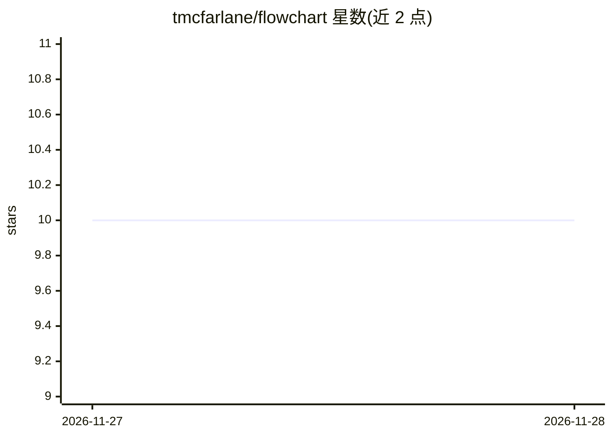

# tmcfarlane/flowchart

⭐ 10 · TypeScript · MIT · 推送 2026-11-15 · [GitHub](https://github.com/tmcfarlane/flowchart) · [官网](https://flowchart.zeroclickdev.ai) · 个人维护

**开源流程图编辑器：手绘或用 AI 生成、共享与自托管图表**

MIT 许可的图表编辑器，含 Flowchart、Architecture、Draw 三种模式，支持原生形状、绑定箭头、标签、图框、Mermaid 子集导入、Excalidraw 文件读写及 PNG/SVG/GIF 导出。AI 生成与精修为可选功能，需自备 Azure 部署或 Cloudflare AI Gateway 配置，默认关闭；画布编辑无需任何 AI 凭据。通过远程 MCP 服务器接入 Claude、ChatGPT、VS Code 等客户端协同编辑图表。提供 git clone 源码运行与自托管路径，Node.js 20+ 与 npm 为本地运行要求，生产环境共享与 MCP 需自配 Redis。

## 筛选速览

| 维度 | 判定 | 备注 |
|---|---|---|
| AI 角色 | `ai-enhanced` | 去掉 AI 部分产品仍成立 |
| 许可风险 | `permissive` | MIT |
| 部署形态 | `None` |  |
| 模型依赖 | — | README 未给出锁定关系 |
| 硬件要求 | — | 无带数字的原话,不猜 |
| 安装摩擦 | `low` | 无编译、无系统依赖或容器化 |
| 成熟度 | — | 结构信号不足 |

## 能力要点

- 三种画布模式：Flowchart、Architecture（含官方 Azure 图标）、Draw（第一方 SVG 编辑器）
- 可选 AI 生成与精修：预览提案后一键插入，默认禁用，画布无需 AI 凭据
- 远程 MCP 服务器：Claude Code 等客户端可创建并持续更新同一图表
- 导出 PNG/SVG/GIF，支持 .excalidraw 导入导出与可编辑分享链接

## 适用场景

- 手绘或 AI 辅助生成流程图与架构图并导出图片
- 让 MCP agent 建图后在浏览器中继续协作编辑
- 自托管图表编辑器用于内网绘图

## 场景标签

 · 领域:开发者工具/可视化

## 证据(README 行号)

> L3: Flowchart AI is an MIT-licensed, open-source diagram editor with Flowchart, Architecture, and Draw modes. Build diag
> L137: Open `http://localhost:3004`. The development server serves the canvas and the local API handlers. No environment 
> L168: Website generation and refinement use your own Azure deployment through `/api/chat`. AI defaults to disabled.

## 星数曲线

2026-11-27 10 → 2026-11-28 10（+0）

---
*卡片 v1 · prompt 1.4 · 生成 2026-11-28 · 置信度 high · 依据 README sha `c20726655e77` · [字段定义](../../DATASET.md)*
