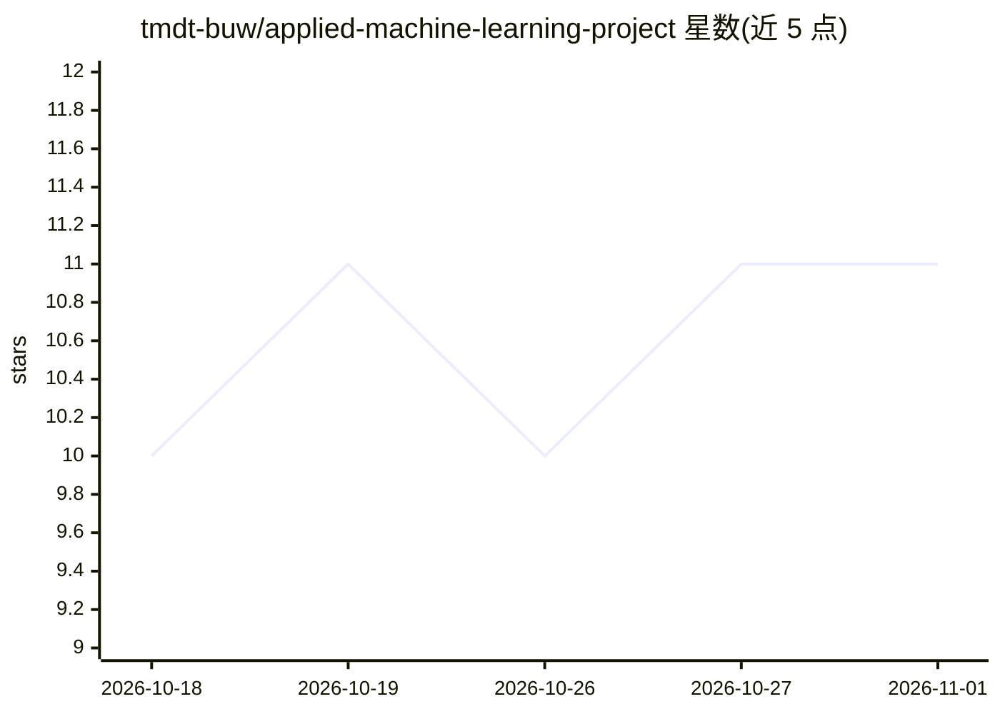

# tmdt-buw/applied-machine-learning-project

⭐ 11 · Python · BSD-3-Clause · 推送 2026-09-17 · [GitHub](https://github.com/tmdt-buw/applied-machine-learning-project) · [官网](https://tmdt-buw.github.io/applied-machine-learning-project/) · 组织维护

**基于电流电压时序数据的焊接质量预测课程项目**

大学应用机器学习课程项目：使用 Zenodo 焊接数据集（约 36 万样本、每样本 200 时间步的电流与电压同步采样，100 kHz），依次完成数据加载与预处理、可视化统计、统计/频域/功率特征提取、自定义 K-means 聚类（含欧氏、曼哈顿与 DTW 距离及 PCA 降维），再以 Random Forest 分类器做焊接质量预测与模型对比评估。Python 实现，依赖 NumPy/Pandas/Scikit-learn 等，通过 uv 管理环境安装。

## 筛选速览

| 维度 | 判定 | 备注 |
|---|---|---|
| AI 角色 | `ai-native` | 本体是模型或模型工具 |
| 许可风险 | `permissive` | BSD-3-Clause |
| 部署形态 | `None` |  |
| 模型依赖 | — | README 未给出锁定关系 |
| 硬件要求 | — | 无带数字的原话,不猜 |
| 安装摩擦 | `low` | 无编译、无系统依赖或容器化 |
| 成熟度 | — | 结构信号不足 |

## 能力要点

- 从电流/电压时序提取统计、频域与功率特征
- 自定义 K-means 支持 Euclidean/Manhattan/DTW 距离并配 PCA 可视化
- Random Forest 分类与特征重要性分析、超参调优、多模型对比
- 数据集约 362,034 样本，形状 [samples, 200, 2]

## 适用场景

- 学习时序特征工程与聚类分析的完整流程
- 复现焊接质量分类预测的实验
- 作为课程练习按 ex_01–ex_06 结构逐步实现

## 场景标签

`教程课程` · 领域:学习与行业

## 证据(README 行号)

> L5: This project focuses on predicting welding quality based on time-series data of electrical current and voltage measu
> L40:  - Implementation of Random Forest classifier

## 星数曲线

2026-10-18 10 → 2026-11-01 11（+1）

---
*卡片 v1 · prompt 1.4 · 生成 2026-11-01 · 置信度 high · 依据 README sha `6b239a20c833` · [字段定义](../../DATASET.md)*
