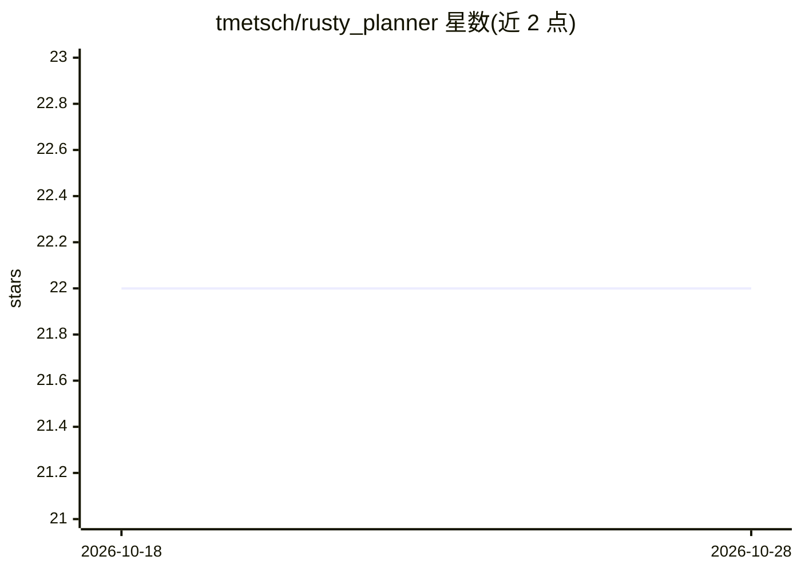

# tmetsch/rusty_planner

⭐ 22 · Rust · MIT · 推送 2026-09-21 · [GitHub](https://github.com/tmetsch/rusty_planner) · 个人维护

**Rust 编写的 AI 规划与推理算法库**

用 Rust 实现的人工智能规划与推理算法库，目标是长期覆盖经典规划、多智能体规划（协调、协商/竞标、联盟形成）与杂项算法。已实现 Anytime Dynamic A*、D* Lite、带模式的 UCT 蒙特卡洛、迭代修复调度、分布式启发式前向搜索与迷宫生成等，部分算法标记为待实现。作者声明该库仍在开发中（work in progress），可能发生重构与较大变更。分布式决策算法需启用 multi_agent feature，迷宫生成需启用 random feature。

## 筛选速览

| 维度 | 判定 | 备注 |
|---|---|---|
| AI 角色 | `ai-ecosystem` | LLM/agent 周边工具 |
| 许可风险 | `permissive` | MIT |
| 部署形态 | `None` |  |
| 模型依赖 | — | README 未给出锁定关系 |
| 硬件要求 | — | 无带数字的原话,不猜 |
| 安装摩擦 | `low` | 无编译、无系统依赖或容器化 |
| 成熟度 | `idea` | |

## 能力要点

- 已实现 Anytime Dynamic A*、D* Lite、UCT、迭代修复调度等经典规划算法
- 多智能体规划方向（协调/协商/联盟形成）部分为待实现路线图
- 可选 feature：multi_agent（分布式决策）与 random（迷宫生成）
- 每项算法均附论文出处引用

## 适用场景

- 在 Rust 项目中集成路径规划与重规划算法（如机器人导航）
- 构建自主系统的规划与推理能力
- 复现经典 AI 规划论文中的算法进行实验

## 场景标签

 · 领域:AI 规划/算法库

## 证据(README 行号)

> L3: This is a library written in Rust containing Artificial Intelligence algorithms - in
> L4: particular those from the field of planning & reasoning. The goal is to support the following algorithms in the long

## 星数曲线

2026-10-18 22 → 2026-10-28 22（+0）

---
*卡片 v1 · prompt 1.4 · 生成 2026-10-27 · 置信度 high · 依据 README sha `b08800991dc6` · [字段定义](../../DATASET.md)*
