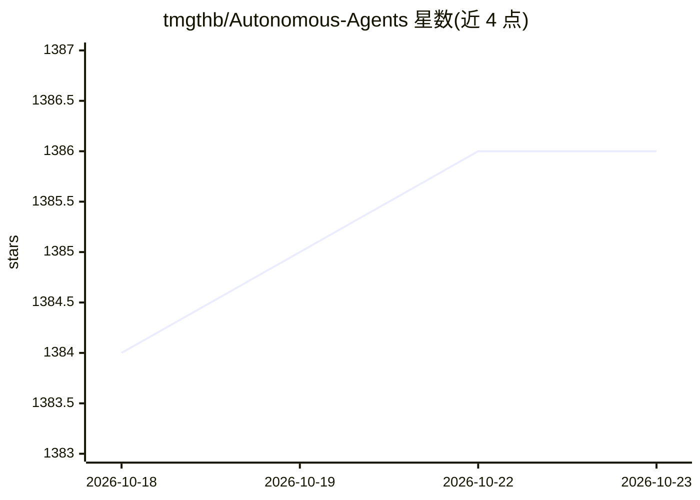

# tmgthb/Autonomous-Agents

⭐ 1,386 · MIT · 推送 2026-06-24 · [GitHub](https://github.com/tmgthb/Autonomous-Agents) · 个人维护

**自主智能体（LLM Agent）研究论文清单，每日更新**

收录 Autonomous Agents / LLM 智能体方向研究论文的策展清单，按时间倒序组织，覆盖 2023 至 2026 年，README 声明每日更新。每条目给出论文名与三行式摘要，说明其提出的框架/方法、机制与实验发现，主题涉及智能体记忆、世界模型、多智能体系统、评测与训练数据等。面向跟踪该领域研究进展的科研人员与开发者，属于纯文献聚合，不含可安装代码。

## 筛选速览

| 维度 | 判定 | 备注 |
|---|---|---|
| AI 角色 | `ai-knowledge` | 知识聚合/清单类 |
| 许可风险 | `permissive` | MIT |
| 部署形态 | `None` |  |
| 模型依赖 | — | README 未给出锁定关系 |
| 硬件要求 | — | 无带数字的原话,不猜 |
| 安装摩擦 | `low` | 无编译、无系统依赖或容器化 |
| 成熟度 | — | 结构信号不足 |

## 能力要点

- 按时间倒序组织的论文时间线（2026 回溯至 Earlier）
- 每条论文附三行式摘要（框架、机制、实验结果）
- 声明每日更新

## 适用场景

- 跟踪 LLM 自主智能体领域的最新论文
- 按时间线回顾该领域的研究脉络
- 快速了解单篇论文的核心贡献与实验结论

## 场景标签

 · 领域:AI 研究知识聚合

## 证据(README 行号)

> L8:  Autonomous Agents-research papers. Updated daily. Resources-section-section.
> L10: ## Research papers: 2026 5/5

## 星数曲线

2026-10-18 1,384 → 2026-10-23 1,386（+2）

---
*卡片 v1 · prompt 1.4 · 生成 2026-10-21 · 置信度 high · 依据 README sha `4d26bf908c80` · [字段定义](../../DATASET.md)*
