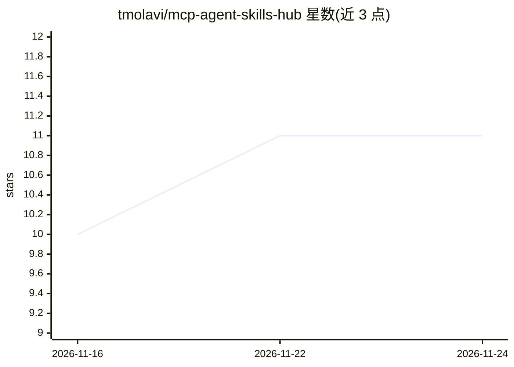

# tmolavi/mcp-agent-skills-hub

⭐ 11 · JavaScript · MIT · 推送 2026-11-17 · [GitHub](https://github.com/tmolavi/mcp-agent-skills-hub) · [官网](https://molavi.pro) · 个人维护

**面向 AI 编码 agent 的 277 个技能与 MCP 配置清单**

由个人维护的策展仓库，提供 277 个去重的 agent 技能（Markdown+YAML frontmatter 格式）与 MCP 服务器配置，覆盖 Web 开发、数据库、SEO/DevOps 等领域；技能文件指导 agent 何时触发、遵循什么规则、如何使用工具并验证操作。安装方式为把技能文件夹复制到项目的 .agents/skills/ 目录，由 Antigravity、Cursor 等 agent 自动发现加载。数据库类 MCP 配置默认只读凭据。

## 筛选速览

| 维度 | 判定 | 备注 |
|---|---|---|
| AI 角色 | `ai-knowledge` | 知识聚合/清单类 |
| 许可风险 | `permissive` | MIT |
| 部署形态 | `library` | 以包/库形式分发 |
| 模型依赖 | — | README 未给出锁定关系 |
| 硬件要求 | — | 无带数字的原话,不猜 |
| 安装摩擦 | `medium` | 含编译或系统依赖之一 |
| 成熟度 | — | 结构信号不足 |

## 能力要点

- 277 个去重技能，按类别自动索引成表
- 技能采用标准 Markdown+YAML frontmatter 格式，agent 自动发现加载
- 数据库 MCP 配置默认只读凭据，破坏性操作加防护
- 内置指令引导 token 节约（范围读取、精确 diff、ignore 文件）

## 适用场景

- 给 Cursor/Antigravity 等编码 agent 添加领域开发规则
- 为 Next.js/FastAPI/Laravel 项目配置代码质量与测试规范
- 配置带只读凭据的数据库 MCP 服务器
- 给项目加技术 SEO/AI 可见性审计技能

## 场景标签

`精选清单` · 领域:学习与行业

## 证据(README 行号)

> L9: A curated, practical collection of agent skills and Model Context Protocol (MCP) server setups designed for real-wor
> L15: This repository provides **277 unique, deduplicated agent skills** packaged as `.skill` configurations (using the s
> L47: Below is a complete, automatically indexed table of all 277 skills available in this repository:

## 星数曲线

2026-11-16 10 → 2026-11-24 11（+1）

---
*卡片 v1 · prompt 1.4 · 生成 2026-11-19 · 置信度 mid · 依据 README sha `5f6026469d47` · [字段定义](../../DATASET.md)*
