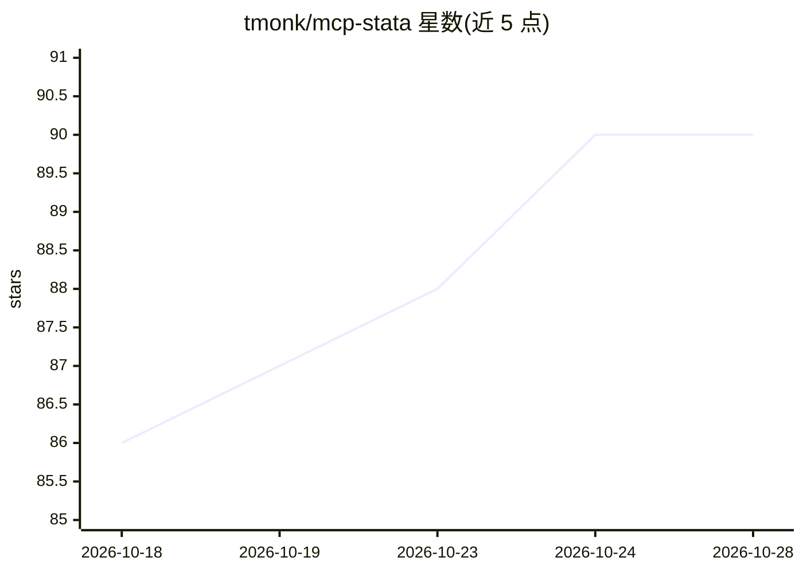

# tmonk/mcp-stata

⭐ 90 · Python · AGPL-3.0 · 推送 2026-05-12 · [GitHub](https://github.com/tmonk/mcp-stata) · [官网](https://tdmonk.com) · 个人维护

**让 AI agent 操作本地 Stata 的 MCP 服务器，面向实证经济学研究**

通过 Model Context Protocol 向 LLM/agent 暴露 Stata 控制能力的 MCP 服务器：AI agent 可执行任意 Stata 命令或 do 文件、检查数据集摘要与 codebook、读取 r()/e()/s() 存储结果、导出与管理图形，并支持后台任务与日志检索。附带技能目录（SKILL.md），覆盖数据审计、复制与稳健性检验、规范比较、出版 QA、审稿回应与旧代码现代化等研究工作流。要求本地已安装授权的 Stata 17+ 与 Python 3.11+，基于随 Stata 附带的 pystata 模块，支持 Claude Desktop、Cursor、VS Code 等客户端。

## 筛选速览

| 维度 | 判定 | 备注 |
|---|---|---|
| AI 角色 | `ai-ecosystem` | LLM/agent 周边工具 |
| 许可风险 | `viral` | AGPL-3.0 |
| 部署形态 | `desktop` | 安装包/桌面程序 |
| 模型依赖 | — | README 未给出锁定关系 |
| 硬件要求 | — | 无带数字的原话,不猜 |
| 安装摩擦 | `low` | 无编译、无系统依赖或容器化 |
| 成熟度 | — | 结构信号不足 |

## 能力要点

- stata_run 等工具：执行命令/do 文件、后台任务、日志读取与检索
- 读取 r()/e()/s() 存储结果的结构化载荷
- do/ado 文件静态 lint 与现代最佳实践检查
- SKILL.md 技能目录：数据审计、复制、出版 QA、审稿回应等工作流

## 适用场景

- 在 Claude/Cursor 等 agent 中直接运行 Stata 回归并核验结果
- 论文复制与稳健性检验：重跑管线、比较规范、保留审计痕迹
- 出版前检查表格图形、组织审稿回应的证据
- 将旧版 Stata 代码现代化（如改用 frames）

## 场景标签

`科研工具` `数据分析` · 领域:效率与自动化

## 证据(README 行号)

> L6: **mcp-stata** is an agentic toolkit for empirical researchers. It gives AI agents native control over a local Stata 
> L12: This server enables LLMs to:
> L147: This MCP server uses the **stdio** transport (the IDE launches the process and communicates over stdin/stdout).

## 星数曲线

2026-10-18 86 → 2026-10-28 90（+4）

---
*卡片 v1 · prompt 1.4 · 生成 2026-10-23 · 置信度 high · 依据 README sha `6bee9261873c` · [字段定义](../../DATASET.md)*
