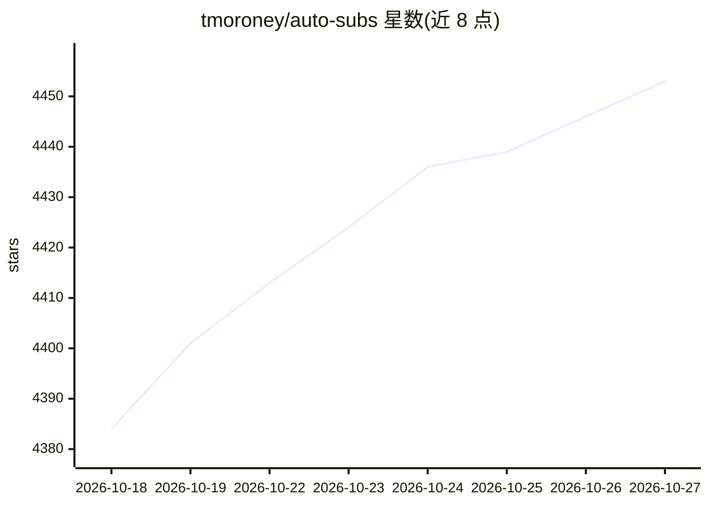

# tmoroney/auto-subs

⭐ 4,453 · TypeScript · MIT · 推送 2026-10-25 · [GitHub](https://github.com/tmoroney/auto-subs) · [官网](https://tom-moroney.com/auto-subs/) · 个人维护

**本地离线语音转字幕工具，对接 Resolve/Premiere/AE**

本地运行的语音转字幕应用：读取音频或视频文件，用 Whisper、Moonshine、Parakeet、SenseVoice、Canary、Cohere、GigaAM、Omni-ASR 等模型系列在设备端生成带时间戳的字幕，支持说话人分离、词级时间戳与翻译。可作为独立应用使用，也可通过 DaVinci Resolve 脚本入口与 Adobe CEP 扩展把字幕写回 Premiere Pro 字幕轨或 After Effects 文本图层。模型按需从应用内 Model Manager 下载，代码 MIT 许可，可选 MMS 对齐权重为 CC BY-NC 4.0。

## 筛选速览

| 维度 | 判定 | 备注 |
|---|---|---|
| AI 角色 | `ai-native` | 本体是模型或模型工具 |
| 许可风险 | `permissive` | MIT |
| 部署形态 | `desktop` | 安装包/桌面程序 |
| 模型依赖 | — | README 未给出锁定关系 |
| 硬件要求 | — | 无带数字的原话,不猜 |
| 安装摩擦 | `low` | 无编译、无系统依赖或容器化 |
| 成熟度 | — | 结构信号不足 |

## 能力要点

- 8 个本地转录模型家族，覆盖 1600+ 语言（Omni-ASR 兜底）
- 说话人分离（diarization）与 Silero VAD，可选 MMS 词级时间戳
- DaVinci Resolve 脚本集成与 Adobe CEP 扩展，字幕直接写回时间线
- 全流程离线，模型按需下载

## 适用场景

- 视频剪辑时直接在 Resolve/Premiere 里生成并导入字幕
- 无需云端服务为本机媒体文件批量转写 SRT
- 多说话人访谈转写并自动标注说话人

## 场景标签

`语音识别` · 领域:感知与多模态

## 证据(README 行号)

> L7: - 🎙️ **Speech to Subtitles:** Turns audio or video into accurate, timestamped subtitles. Pick from several AI models
> L91: AutoSubs ships with several local transcription model families. All run fully on-device — nothing is sent to the cl
> L184: AutoSubs can run as a standalone subtitle generator, connect directly to DaVinci Resolve, or communicate with Adob

## 星数曲线

2026-10-18 4,384 → 2026-10-27 4,453（+69）

---
*卡片 v1 · prompt 1.4 · 生成 2026-10-20 · 置信度 high · 依据 README sha `49caec824b74` · [字段定义](../../DATASET.md)*
