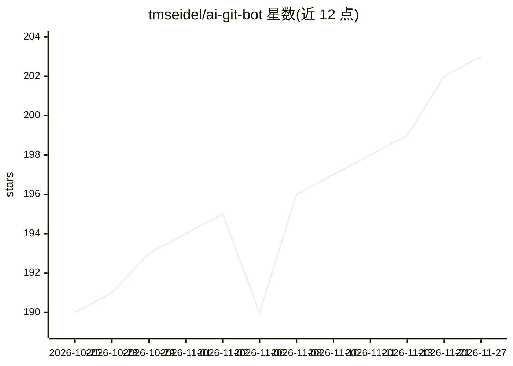

# tmseidel/ai-git-bot

⭐ 203 · Java · MIT · 推送 2026-11-26 · [GitHub](https://github.com/tmseidel/ai-git-bot) · [官网](https://gitbot.eu) · 个人维护

**自托管的 Git 仓库 AI 工作流自动化平台**

部署在团队自有基础设施中的 Git 机器人平台，接入 Gitea/GitHub/GitLab/Bitbucket/Azure DevOps，在 PR 打开、issue 分配、@bot 提及等 Git 事件触发时执行工作流：PR 审查评论、单元测试生成、Playwright E2E 测试与预览环境、issue 结构化改写与分派路由、README/i18n 同步、issue 直接转为 PR。AI 提供方可组合 OpenAI/Anthropic/Gemini 或本地 Ollama、llama.cpp；内置 H2 数据库可 Docker 单命令启动，支持 Prometheus 指标与 HMAC 签名 Webhook。

## 筛选速览

| 维度 | 判定 | 备注 |
|---|---|---|
| AI 角色 | `ai-native` | 本体是模型或模型工具 |
| 许可风险 | `permissive` | MIT |
| 部署形态 | `self-host` | docker 或自建部署 |
| 模型依赖 | local-ok | 支持本地模型 |
| 硬件要求 | — | 无带数字的原话,不猜 |
| 安装摩擦 | `low` | 无编译、无系统依赖或容器化 |
| 成熟度 | — | 结构信号不足 |

## 能力要点

- PR 审查、单元测试与 Playwright E2E + 预览环境部署等 12+ 种事件触发工作流
- AI 提供方与 Git 平台自由组合，支持 OpenAI-compatible API 与本地模型
- 可全自托管，代码、提示词与模型留在私有网络内
- 内置 Prometheus 指标端点与签名出站 Webhook

## 适用场景

- Gitea 等自托管 Git 平台补齐 AI 审查与测试自动化能力
- 合规/隐私要求下用本地模型跑 AI 代码审查
- 把 issue 自动转成实现 PR 或结构化工作项
- 自动保持 README 与翻译文件随代码变更同步

## 场景标签

`代码审查` · 领域:编码与开发

## 证据(README 行号)

> L11: > **The self-hosted AI workflow automation platform for Git repositories.**
> L116: ## 🔌 Mix any AI provider with any Git platform

## 星数曲线

2026-10-25 190 → 2026-11-27 203（+13）

---
*卡片 v1 · prompt 1.4 · 生成 2026-11-25 · 置信度 high · 依据 README sha `2882707c6a63` · [字段定义](../../DATASET.md)*
