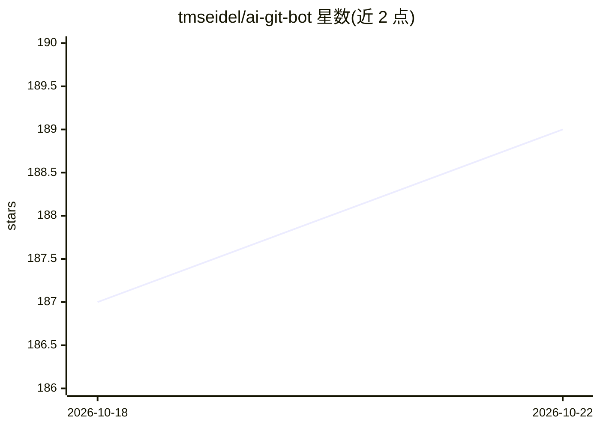

# tmseidel/ai-git-bot

⭐ 190 · Java · MIT · 推送 2026-10-21 · [GitHub](https://github.com/tmseidel/ai-git-bot) · [官网](https://gitbot.eu) · 个人维护

**自托管的 Git 仓库 AI 工作流自动化平台**

部署在自己基础设施内的服务，接入 Gitea/GitHub/GitLab/Bitbucket 与多种 AI 提供商（Anthropic、OpenAI、Gemini、Ollama、llama.cpp），把 PR 审查、单测/E2E 测试生成、issue 精炼与分派路由、issue 转 PR、README 同步、i18n 补齐等工程事务转为由 Git 事件触发的自动化工作流。bot 以评论形式在 Git 平台内响应，支持本地模型满足代码不出内网的合规要求，提供 Prometheus 指标与签名 Webhook。以 Docker 镜像（amd64/arm64）或 Docker Compose 部署。

## 筛选速览

| 维度 | 判定 | 备注 |
|---|---|---|
| AI 角色 | `ai-ecosystem` | LLM/agent 周边工具 |
| 许可风险 | `permissive` | MIT |
| 部署形态 | `self-host` | docker 或自建部署 |
| 模型依赖 | local-ok | 支持本地模型 |
| 硬件要求 | — | 无带数字的原话,不猜 |
| 安装摩擦 | `low` | 无编译、无系统依赖或容器化 |
| 成熟度 | — | 结构信号不足 |

## 能力要点

- PR 审查、issue 路由/精炼、issue→PR 编码代理、单测与 Playwright E2E 生成等工作流
- 任意 AI 提供商搭配任意 Git 平台，支持 Ollama/llama.cpp 本地模型
- README 同步与 i18n 多语言文件补齐工作流
- Prometheus 指标端点与 HMAC 签名的出站 Webhook

## 适用场景

- 团队希望自动审查每个 PR 并生成回归测试
- 使用 Gitea 等自托管 Git 平台但缺少 AI 工具链
- 合规要求源码不外发，需要本地模型驱动的工程自动化

## 场景标签

 · 领域:开发工具/DevOps 自动化

## 证据(README 行号)

> L11: > **The self-hosted AI workflow automation platform for Git repositories.**
> L116: ## 🔌 Mix any AI provider with any Git platform
> L125: Unlike most AI coding tools, AI-Git-Bot is not tied to a specific Git platform or AI provider.

## 星数曲线

2026-10-18 187 → 2026-10-22 189（+2）

---
*卡片 v1 · prompt 1.4 · 生成 2026-10-22 · 置信度 high · 依据 README sha `03b88b3b840c` · [字段定义](../../DATASET.md)*
