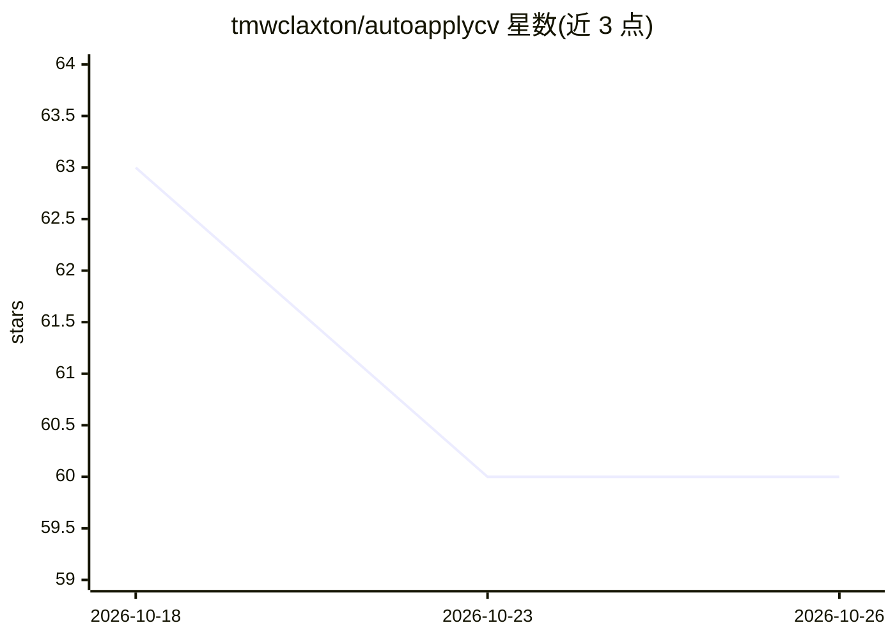

# tmwclaxton/autoapplycv

⭐ 60 · JavaScript · NOASSERTION · 推送 2026-10-21 · [GitHub](https://github.com/tmwclaxton/autoapplycv) · [官网](https://www.autocvapply.com) · 组织维护

**求职者的浏览器扩展：自动填写求职表单并起草答案与求职信**

面向在多 ATS 平台投递简历的求职者的 Chrome/Firefox 扩展：上传 CV 后经 Tesseract OCR + NanoGPT 抽取为结构化档案，在 Greenhouse、Ashby、Workday 等 ATS 表单上一键自动填写字段，并提供 Draft All 流式生成自由文本答案、按职位定制求职信与简历、ATS 关键词评分。支持 LinkedIn、Indeed、Totaljobs、Glassdoor、Reed 五个招聘板端到端自动投递（默认提交前暂停），含验证码自动识别。后端为 Laravel 13 + Vue 3 + Inertia v3 + PHP 8.5，许可为 PolyForm Noncommercial 1.0.0。

## 筛选速览

| 维度 | 判定 | 备注 |
|---|---|---|
| AI 角色 | `ai-enhanced` | 去掉 AI 部分产品仍成立 |
| 许可风险 | `none` | NOASSERTION |
| 部署形态 | `self-host` | docker 或自建部署 |
| 模型依赖 | — | README 未给出锁定关系 |
| 硬件要求 | — | 无带数字的原话,不猜 |
| 安装摩擦 | `low` | 无编译、无系统依赖或容器化 |
| 成熟度 | — | 结构信号不足 |

## 能力要点

- CV 上传后经 Tesseract OCR + NanoGPT 抽取为结构化档案并自动填写 ATS 表单（含 Shadow DOM/iframe 嵌入组件）
- Draft All 流式生成自由文本答案，生成内容按 grounding/人味语气/格式/诚实度评分
- LinkedIn、Indeed、Totaljobs、Glassdoor、Reed 五个招聘板端到端自动投递，默认提交前暂停供人工复核
- reCAPTCHA v2、hCaptcha、Turnstile 自动识别，交互式挑战暂停等待手动完成后继续

## 适用场景

- 在一周内跨多个 ATS 平台投递，避免重复填写联系方式与学历等信息
- 需要针对每个职位定制求职信与简历草稿
- 在 LinkedIn/Indeed 等招聘板上批量自动投递并保留提交前人工检查环节

## 场景标签

`浏览器自动化` `AI 写作` · 领域:效率与自动化

## 证据(README 行号)

> L52: |Blank stare at "Why do you want this role?" textareas|**Draft All** streams AI answers for free-text questions|
> L115: |**4. Fill and draft**|Autofill fields on any job form. **Draft All** streams AI-written answers for free-text que

## 星数曲线

2026-10-18 63 → 2026-10-26 60（-3）

---
*卡片 v1 · prompt 1.4 · 生成 2026-10-24 · 置信度 low · 依据 README sha `6ca03d69baee` · [字段定义](../../DATASET.md)*
