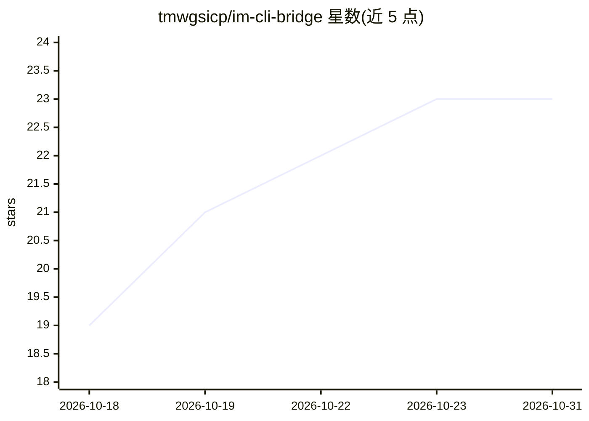

# tmwgsicp/im-cli-bridge

⭐ 23 · JavaScript · 推送 2026-07-07 · [GitHub](https://github.com/tmwgsicp/im-cli-bridge) · 个人维护 · 中文 README

**把 IM 平台桥接到 AI 编程 CLI 的手机远程编程工具**

Node.js 桥接器：连接微信、Telegram、Discord、飞书、Slack、企业微信 6 种 IM 平台与 Claude Code、Codex、Cursor、Gemini、Kiro、Qwen 6 种 AI 编程 CLI，用户在手机上发消息远程操控服务器上的 CLI，结果实时返回。自身不含 AI 能力，直接调用已安装登录的官方 CLI。支持 pm2 多平台/多 Bot 部署、定时任务、异步长任务、上下文摘要与人设切换。需 Node.js 22+ 环境及预装的 CLI 工具。

## 筛选速览

| 维度 | 判定 | 备注 |
|---|---|---|
| AI 角色 | `ai-ecosystem` | LLM/agent 周边工具 |
| 许可风险 | `none` | — |
| 部署形态 | `library` | 以包/库形式分发 |
| 模型依赖 | — | README 未给出锁定关系 |
| 硬件要求 | — | 无带数字的原话,不猜 |
| 安装摩擦 | `low` | 无编译、无系统依赖或容器化 |
| 成熟度 | — | 结构信号不足 |

## 能力要点

- 6 种 IM 平台与 6 种 AI CLI 的双向桥接，消息指令实时返回
- pm2 单平台、多平台、同平台多 Bot 三种部署模式
- 定时任务（Cron）、异步长任务后台执行与完成通知
- /context 上下文摘要注入与 /persona 人设切换命令

## 适用场景

- 在手机上通过 Telegram/微信远程操控服务器上的 Claude Code 写代码
- 一台服务器同时接入多个 IM 平台或多 Bot 服务不同成员
- 定时让 CLI 执行代码分析等周期任务并接收通知

## 场景标签

 · 领域:开发者工具/AI 编程

## 证据(README 行号)

> L16: 这是一个 **IM-CLI 桥接器**，连接任意即时通讯平台和各种 AI 编程工具，让你在手机上远程操控电脑/服务器上的 CLI。
> L27: - 这是一个桥接器 -- 连接 IM 和 CLI 工具的中间层
> L33: - 不是 AI 本身 -- AI 能力来自 Claude、Codex 等官方 CLI 工具

## 星数曲线

2026-10-18 19 → 2026-10-31 23（+4）

---
*卡片 v1 · prompt 1.4 · 生成 2026-10-27 · 置信度 mid · 依据 README sha `1c686e93b23c` · [字段定义](../../DATASET.md)*
