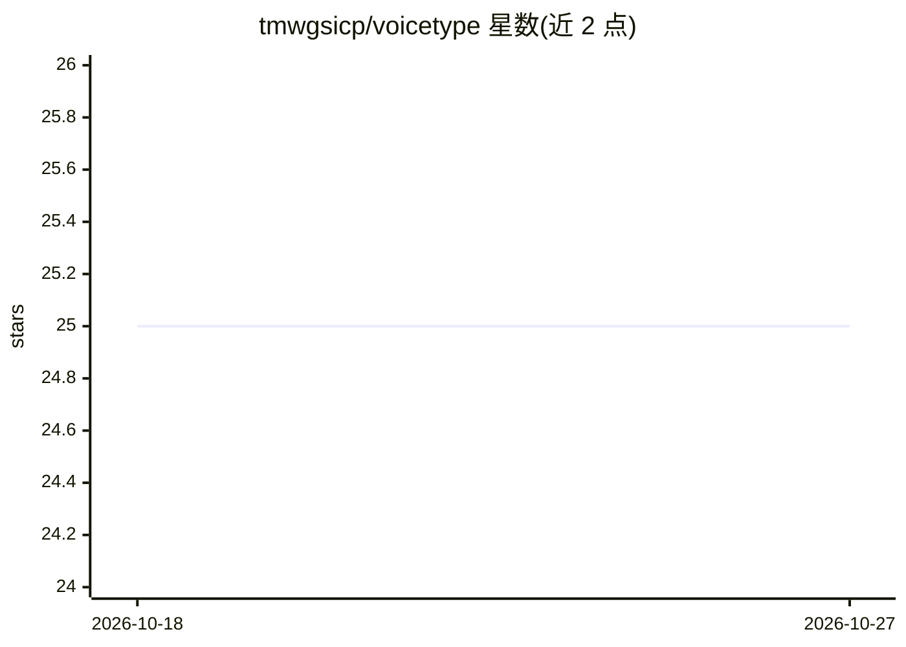

# tmwgsicp/voicetype

⭐ 25 · Python · AGPL-3.0 · 推送 2026-08-01 · [GitHub](https://github.com/tmwgsicp/voicetype) · 个人维护 · 中文 README

**本地/云双模式的 AI 语音输入桌面工具，含声纹与唤醒**

基于 Tauri 2.0 + Vue 3 + FastAPI 的跨平台语音输入工具：按 F9 或唤醒词触发录音，将语音转文字并输出到活动窗口。默认本地 Sherpa-ONNX 中英双语模型（延迟 50-80ms、无需 API Key），可切换阿里云/腾讯云等云端 ASR；支持 3D-Speaker 本地声纹验证、关键词唤醒、按活动窗口切换规则的场景引擎，以及 Qwen/GPT/DeepSeek/GLM 做 LLM 文本后处理。Windows 提供安装包（约 600MB，模型内置），macOS 版处于测试中；AGPL-3.0 开源，另提供闭源商业授权通道。

## 筛选速览

| 维度 | 判定 | 备注 |
|---|---|---|
| AI 角色 | `ai-native` | 本体是模型或模型工具 |
| 许可风险 | `dual` | AGPL-3.0 |
| 部署形态 | `desktop` | 安装包/桌面程序 |
| 模型依赖 | locked-api |  |
| 硬件要求 | — | 无带数字的原话,不猜 |
| 安装摩擦 | `low` | 无编译、无系统依赖或容器化 |
| 成熟度 | `idea` | |

## 能力要点

- 本地 Sherpa-ONNX 双语 ASR 离线运行，语音数据不出本机
- 本地声纹识别（3 轮注册 + 余弦相似度阈值）与自定义关键词唤醒
- 按活动窗口（IDE/Office/浏览器/聊天）自动切换识别规则与提示词
- LLM 后处理：纠错、标点、格式化、口语转书面语

## 适用场景

- 日常办公与代码输入时用语音代替键盘打字
- 隐私敏感场景下完全离线使用语音转文字
- 残疾人、老年人等无障碍场景免按键语音输入

## 场景标签

`语音识别` · 领域:感知与多模态

## 证据(README 行号)

> L25:  - 本地 ASR 模型，语音数据不出本机
> L43:  - **本地离线模式** — Sherpa-ONNX 中英双语模型，完全本地运行，隐私保护，零 API 成本
> L151: - **模型**: Sherpa-ONNX 中英双语模型 (530MB)

## 星数曲线

2026-10-18 25 → 2026-10-27 25（+0）

---
*卡片 v1 · prompt 1.4 · 生成 2026-10-26 · 置信度 mid · 依据 README sha `d9ad5ed78298` · [字段定义](../../DATASET.md)*
