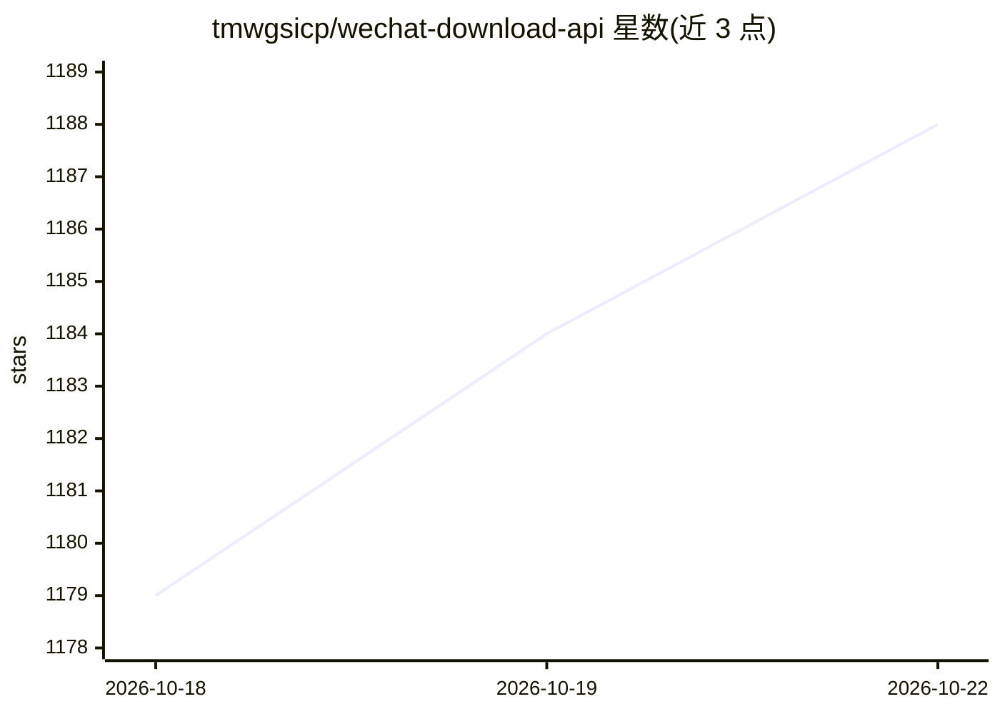

# tmwgsicp/wechat-download-api

⭐ 1,188 · Python · AGPL-3.0 · 推送 2026-07-27 · [GitHub](https://github.com/tmwgsicp/wechat-download-api) · [官网](https://wechatrss.waytomaster.com) · 个人维护 · 中文 README

**微信公众号文章获取与 RSS 订阅 API 服务，支持多格式导出**

基于 FastAPI 的自托管服务：通过微信公众平台扫码登录凭证，提供文章内容解析、公众号搜索、文章列表与关键词搜索等 HTTP API，生成含全文的 RSS 2.0 源接入 FreshRSS/Feedly 等阅读器；支持整号文章一键导出 Markdown/HTML/Word/PDF/EPUB/Excel/JSON 七种格式。内置 SOCKS5 代理池、Chrome TLS 指纹模拟与三层限频应对微信风控。另提供 MCP 服务（6 个工具、静态 Token 鉴权）供 Claude/Cursor 等 AI 客户端直接搜索、订阅、读文章。限制：需拥有公众号并用管理员微信扫码登录，凭证约 4 天有效期需重新扫码。提供 Docker 与一键脚本部署。

## 筛选速览

| 维度 | 判定 | 备注 |
|---|---|---|
| AI 角色 | `ai-enhanced` | 去掉 AI 部分产品仍成立 |
| 许可风险 | `viral` | AGPL-3.0 |
| 部署形态 | `self-host` | docker 或自建部署 |
| 模型依赖 | — | README 未给出锁定关系 |
| 硬件要求 | — | 无带数字的原话,不猜 |
| 安装摩擦 | `low` | 无编译、无系统依赖或容器化 |
| 成熟度 | — | 结构信号不足 |

## 能力要点

- 整号文章一键导出 7 种格式，纯读本地库不触发抓取
- RSS 订阅含完整图文内容，支持批量添加、聚合源与分类源
- MCP 服务提供 6 个工具供 AI 客户端接入，静态 Token 鉴权
- SOCKS5 代理池轮转 + Chrome TLS 指纹模拟 + 三层自动限频

## 适用场景

- 用 RSS 阅读器订阅微信公众号全文内容
- 把公众号存量文章打包成 Markdown 喂给 AI 或导入 Obsidian
- 让 Claude/Cursor 等 AI 客户端通过 MCP 直接搜索和阅读公众号文章

## 场景标签

 · 领域:内容聚合/微信公众号工具

## 证据(README 行号)

> L17: - **RSS 订阅** — 订阅任意公众号，自动定时拉取新文章（**包含完整文章内容和图片**），生成标准 RSS 2.0 源，接入 FreshRSS / Feedly 等阅读器即可使用；支持**批量添加**（粘多个公众号名称一
> L20: - **多格式导出** — 单篇 markdown 增量同步（带 YAML frontmatter，导入 Obsidian / Logseq）；整号文章一键打包成 **Markdown / HTML / Word / PDF / 
> L179: 内置 **MCP（Model Context Protocol）服务**，让 Claude、Codex、Cline、Cursor 等 AI 客户端**直接搜索公众号、订阅、读文章**，不用切网页、不用手动调接口——对 AI 说"

## 星数曲线

2026-10-18 1,179 → 2026-10-22 1,188（+9）

---
*卡片 v1 · prompt 1.4 · 生成 2026-10-21 · 置信度 high · 依据 README sha `5474dd95d7c7` · [字段定义](../../DATASET.md)*
