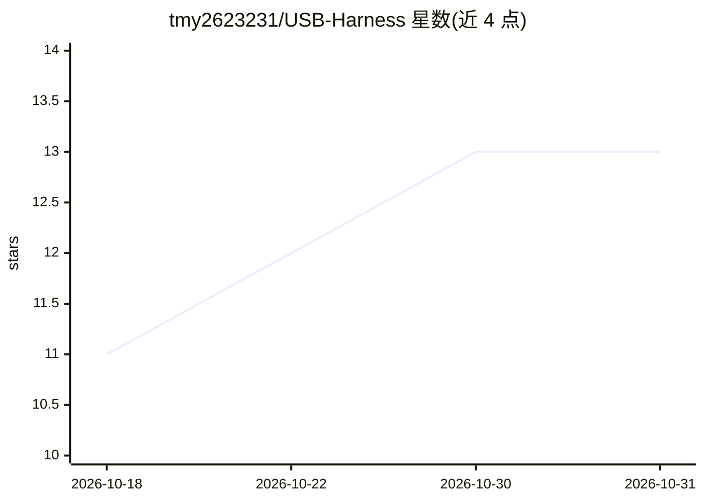

# tmy2623231/USB-Harness

⭐ 13 · JavaScript · MIT · 推送 2026-09-18 · [GitHub](https://github.com/tmy2623231/USB-Harness) · 个人维护 · 中文 README

**把 DeepSeek Harness 装进 U 盘的免安装便携 AI 助手**

deepseek-harness（dsh）的便携式打包：Releases 完整包自带便携 Node 与 dsh 依赖（约 136MB），解压到 U 盘后双击 launch.bat / 运行 launch.sh 即可启动 dsh 的 Web 对话界面或 headless 命令模式，宿主机无需安装 Node/npm/Python。模型侧不内置凭据，需自行配置 OpenAI 兼容网关（Ollama / 阿里云百炼 / OpenRouter / vLLM 等）。数据（配置、会话、密钥）随盘存储，NTFS/exFAT/FAT32 均可运行（后两者回退为目录复制，装插件不可用）；Node 下载走 npmmirror 镜像并预置离线安装包。当前版本 0.1.5-rc.2 跟随上游 rc 预发布。

## 筛选速览

| 维度 | 判定 | 备注 |
|---|---|---|
| AI 角色 | `ai-native` | 本体是模型或模型工具 |
| 许可风险 | `permissive` | MIT |
| 部署形态 | `desktop` | 安装包/桌面程序 |
| 模型依赖 | local-ok | 支持本地模型 |
| 硬件要求 | — | 无带数字的原话,不猜 |
| 安装摩擦 | `low` | 无编译、无系统依赖或容器化 |
| 成熟度 | `idea` | |

## 能力要点

- 完整包含便携 Node + dsh 依赖，解压即用、零宿主机污染
- 支持任意 OpenAI 兼容网关（Ollama / 阿里云百炼 / OpenRouter / vLLM / 本地模型）
- Web 界面与 headless 命令模式双形态，默认监听 0.0.0.0:3080 支持局域网访问
- DSH_HOME 重定向实现配置/会话/密钥数据随盘，软重置保留运行环境

## 适用场景

- 在离线/内网环境中免安装运行 LLM 对话界面
- 用 U 盘在多台电脑间携带 AI 助手与全部配置会话
- 国内网络环境下通过镜像加速完成首次安装
- 一台电脑起服务，手机/平板经局域网浏览器访问

## 场景标签

`AI 助手` `聊天机器人` · 领域:对话与助手

## 证据(README 行号)

> L15: > **一句话**：把 DeepSeek Harness 的全部 AI 能力装进一个 **U 盘**——
> L96: - ✅ **100% dsh 能力**：Web UI、实时对话、流式输出、模型加载、headless、工具/插件、MCP、权限模式
> L246: - **API 地址**：OpenAI 兼容网关地址，如 `https://your-gateway.example.com/v1`、本地 Ollama `http://127.0.0.1:11434/v1`

## 星数曲线

2026-10-18 11 → 2026-10-31 13（+2）

---
*卡片 v1 · prompt 1.4 · 生成 2026-10-31 · 置信度 high · 依据 README sha `70f687418559` · [字段定义](../../DATASET.md)*
