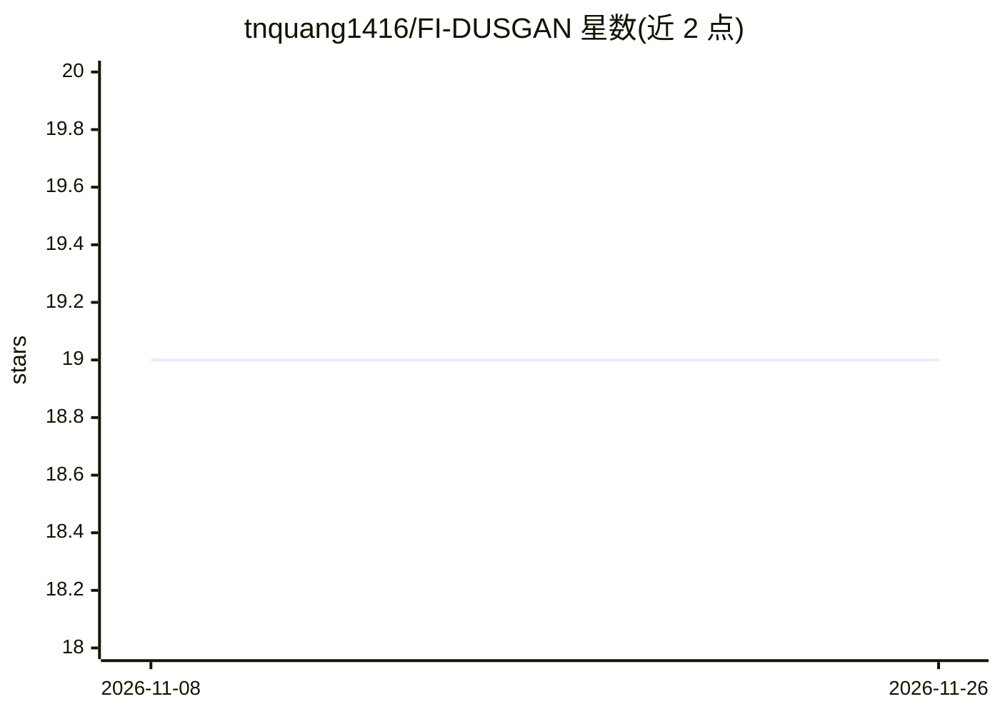

# tnquang1416/FI-DUSGAN

⭐ 19 · Python · MIT · 推送 2026-11-08 · [GitHub](https://github.com/tnquang1416/FI-DUSGAN) · 个人维护

**视频帧插值论文 FI-DUSGAN 的官方 PyTorch 实现**

Tran 与 Yang 2022 年发表于 Computer Vision and Image Understanding 的论文《Video Frame Interpolation Via Down-Up Scale Generative Adversarial Networks》的官方实现。基于 PyTorch（建议 1.5.0 或更高版本），目标数据集为 Vimeo-90k 帧插值子集，通过 train.py 训练；预训练模型托管在 Google Drive，需重命名为 net_gen.pt 放入 pre-trained 文件夹。面向复现论文或做视频帧插值研究的开发者与科研人员。

## 筛选速览

| 维度 | 判定 | 备注 |
|---|---|---|
| AI 角色 | `ai-native` | 本体是模型或模型工具 |
| 许可风险 | `permissive` | MIT |
| 部署形态 | `None` |  |
| 模型依赖 | — | README 未给出锁定关系 |
| 硬件要求 | — | 无带数字的原话,不猜 |
| 安装摩擦 | `low` | 无编译、无系统依赖或容器化 |
| 成熟度 | — | 结构信号不足 |

## 能力要点

- 提供论文官方 PyTorch 实现（建议 PyTorch ≥ 1.5.0）
- 面向 Vimeo-90k 帧插值子集组织数据
- 通过 Google Drive 提供预训练模型 net_gen.pt
- README 附论文 DOI 引用信息

## 适用场景

- 复现 CVIU 2022 帧插值论文实验
- 在 Vimeo-90k 数据集上训练帧插值 GAN 模型
- 下载预训练模型生成中间视频帧

## 场景标签

`科研工具` `图像视频处理` · 领域:学习与行业

## 证据(README 行号)

> L2: This is the official implementation for Video Frame Interpolation Via Down-Up Scale Generative Adversarial Networks 
> L13: ```python train.py --path=cpt_folder```

## 星数曲线



2026-11-08 19 → 2026-11-26 19（+0）


---
*卡片 v1 · prompt 1.4 · 生成 2026-11-18 · 置信度 high · 依据 README sha `b345cf59c5fb` · [字段定义](../../DATASET.md)*
