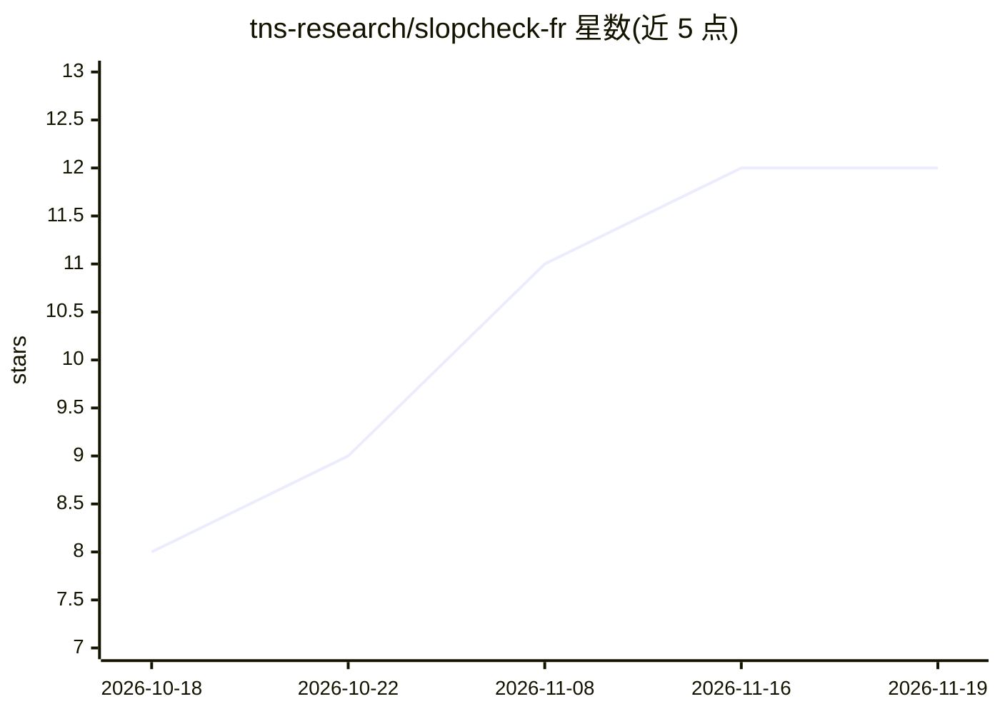

# tns-research/slopcheck-fr

⭐ 12 · Python · MIT · 推送 2026-10-10 · [GitHub](https://github.com/tns-research/slopcheck-fr) · 组织维护

**检测法语文本中 AI 写作痕迹的规则式 linter**

面向法语文本作者的命令行检测工具：基于 TOML 规则（默认包 50 条，严格包另加 37 条）识别 10 类 AI 写作痕迹（假对比、项目符号表情、破折号、三段式排比等），输出 BLOCK/WARN 告警与改写建议，并给出每条规则在 120 万词人类语料上的误报率。无网络调用、无模型推理、毫秒级确定性输出；同时以 Agent Skills 格式（SKILL.md）接入代码 agent，要求其在交稿前修复至零 BLOCK。

## 筛选速览

| 维度 | 判定 | 备注 |
|---|---|---|
| AI 角色 | `ai-native` | 本体是模型或模型工具 |
| 许可风险 | `permissive` | MIT |
| 部署形态 | `library` | 以包/库形式分发 |
| 模型依赖 | — | README 未给出锁定关系 |
| 硬件要求 | — | 无带数字的原话,不猜 |
| 安装摩擦 | `low` | 无编译、无系统依赖或容器化 |
| 成熟度 | — | 结构信号不足 |

## 能力要点

- 50+37 条 TOML 规则，支持 slopcheck learn 从单句生成自定义规则并在人类语料上测误报
- BLOCK 退出码 1 可用于阻断 commit/CI，支持 pre-commit 与 GitHub Actions 注释
- 支持 Claude Code、Codex、Cursor、Gemini CLI 等 agent 的 SKILL.md 格式
- 无依赖、离线运行，文本不离开本机

## 适用场景

- 发布前清理法语博客文章或 LinkedIn 帖子中的 AI 痕迹
- 在 CI/pre-commit 中阻断含 BLOCK 级 AI 痕迹的 markdown 合入
- 让代码 agent 在生成法语文案后自动自检并修复

## 场景标签

`AI 写作` · 领域:内容生成

## 证据(README 行号)

> L3: **Le correcteur des tics d'écriture IA, pour vos textes en français.**
> L23:  Un skill pour votre agent de code : il passe slopcheck sur chaque texte qu'il rédige et corrige avant de vous le r
> L85: Le dépôt contient un `SKILL.md` au format Agent Skills, lu par Claude Code, Codex, Cursor, Gemini CLI, Grok Build, 

## 星数曲线

2026-10-18 8 → 2026-11-19 12（+4）

---
*卡片 v1 · prompt 1.4 · 生成 2026-11-18 · 置信度 high · 依据 README sha `f9bce619cc35` · [字段定义](../../DATASET.md)*
