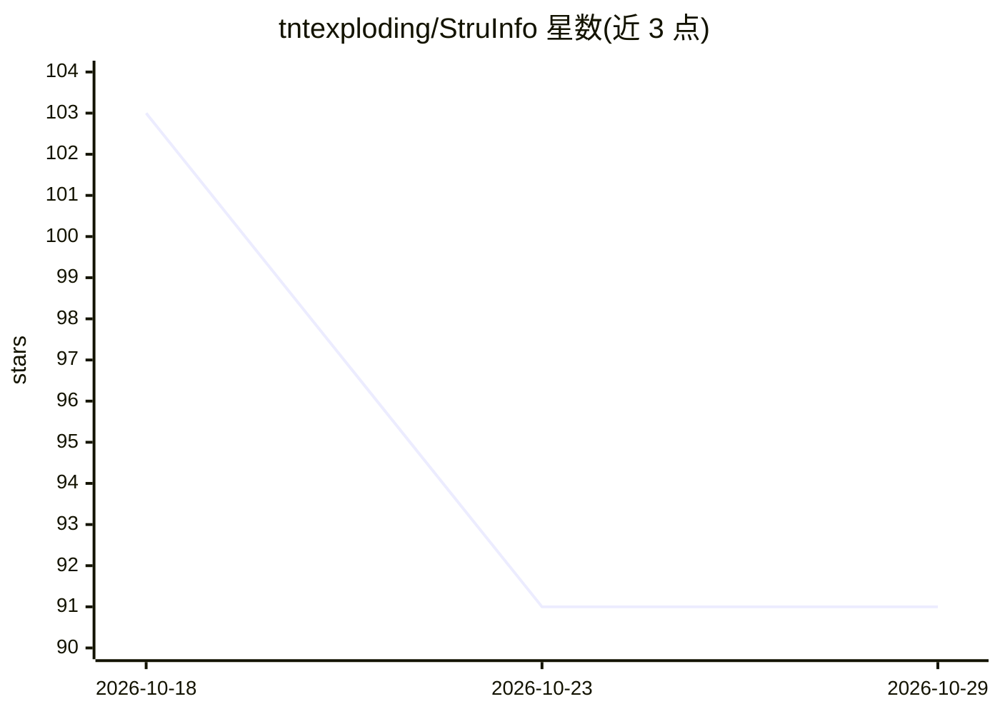

# tntexploding/StruInfo

⭐ 91 · TypeScript · MIT · 推送 2026-10-28 · [GitHub](https://github.com/tntexploding/StruInfo) · 个人维护 · 中文 README

**自托管个人知识库工作区：订阅/文档整理、检索、问答与报告**

自托管的单所有者个人文档工作区：订阅 RSS/Atom、上传 Markdown/PDF 等文档，经审核后在工作台拆分、打标签、建立联系，再用于搜索、知识库问答和日报/周报/专题报告。原文与整理结果分开保存，条目可回到出处。AI 默认不配置，可选接入 DeepSeek 或 OpenAI 完成审核、整理、翻译、问答；无模型也可手动整理和词法搜索。外部 Agent 可经 MCP 接口操作。通过 Docker Compose + PostgreSQL 部署。

## 筛选速览

| 维度 | 判定 | 备注 |
|---|---|---|
| AI 角色 | `ai-enhanced` | 去掉 AI 部分产品仍成立 |
| 许可风险 | `permissive` | MIT |
| 部署形态 | `self-host` | docker 或自建部署 |
| 模型依赖 | — | README 未给出锁定关系 |
| 硬件要求 | — | 无带数字的原话,不猜 |
| 安装摩擦 | `low` | 无编译、无系统依赖或容器化 |
| 成熟度 | — | 结构信号不足 |

## 能力要点

- RSS/Atom 订阅与文档上传，原文与整理结果分离保存、条目可溯源
- AI 可选：审核、拆分、标签、联系、翻译、问答与报告，支持并发与价格时段限制
- 词法搜索、知识图谱、报告生成，无模型也可使用
- 外部 Agent 经 MCP 接口以独立令牌操作

## 适用场景

- 把订阅和上传的文档整理成可检索的个人知识库
- 向自己的知识库提问并生成日报/周报/专题报告
- 让外部 Agent 经 MCP 接入知识库做读取或写入

## 场景标签

`知识库管理` `文档问答` · 领域:知识与检索

## 证据(README 行号)

> L11: StruInfo 是自托管的个人文档工作区。订阅来源、上传文档、审核内容，然后在同一处阅读、拆分、打标签和建立联系。整理好的内容可以用于搜索、知识库问答和日报、周报、月报、专题报告。
> L61: AI 默认不配置。安装完成后，按模型配置说明设置 DeepSeek 或 OpenAI 的模型与外部密钥文件，再在设置中选择允许的操作。
> L68: 模型调用可能产生费用。自动处理范围、重试额度和价格时段由你配置；没有模型也能完成导入、手动整理、词法搜索和资料摘录。语义向量检索需要另行配置 Embedding 模型。

## 星数曲线

2026-10-18 103 → 2026-10-29 91（-12）

---
*卡片 v1 · prompt 1.4 · 生成 2026-10-23 · 置信度 mid · 依据 README sha `ecd4005f8b1f` · [字段定义](../../DATASET.md)*
