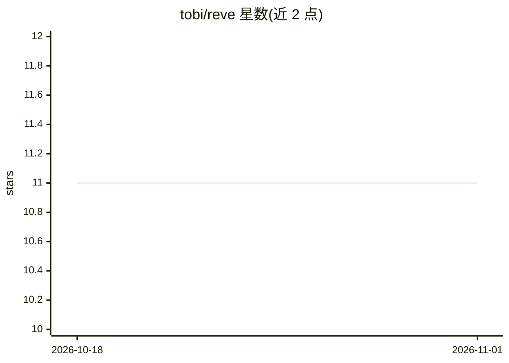

# tobi/reve

⭐ 11 · Rust · MIT · 推送 2026-08-22 · [GitHub](https://github.com/tobi/reve) · [官网](https://github.com/tobi/reve) · 个人维护

**以目录为载体的 Ruby/Rust 编码代理，命令强制运行在 microVM 沙箱**

用 Rust 编写、Lua 做配置与工具脚本的持久化编码代理：整个代理（身份、模型配置、工具、记忆、沙箱策略、历史）收敛为一个可复制的目录，复制目录即复制代理。所有模型发起的命令与工具的 ctx.sh 都在强制 microsandbox microVM（锁定 =0.6.8）内执行，无主机 shell 回退；网络默认拒绝、按主机名放行，密钥按主机作用域注入。会话以 JSONL 追加树形式落盘，支持崩溃后恢复与续跑。需 Rust 1.91+、Linux(KVM) 或 Apple Silicon macOS。

## 筛选速览

| 维度 | 判定 | 备注 |
|---|---|---|
| AI 角色 | `ai-native` | 本体是模型或模型工具 |
| 许可风险 | `permissive` | MIT |
| 部署形态 | `library` | 以包/库形式分发 |
| 模型依赖 | — | README 未给出锁定关系 |
| 硬件要求 | — | 无带数字的原话,不猜 |
| 安装摩擦 | `medium` | 含编译或系统依赖之一 |
| 成熟度 | `idea` | |

## 能力要点

- 代理完整状态收敛为单个可复制目录（'目录即代理'）
- 所有模型命令强制运行在 microsandbox microVM，VM 无法启动则拒绝运行
- 网络默认拒绝、按主机名白名单放行，密钥带主机作用域
- JSONL 追加式会话树，崩溃后可按意图安全恢复

## 适用场景

- 在强隔离沙箱里让 AI 代理执行编码与命令任务
- 把代理配置、工具与记忆作为普通文件用文件系统工具检查和迁移
- 随时中断并恢复代理会话而不丢历史

## 场景标签

`编码 Agent` · 领域:编码与开发

## 证据(README 行号)

> L6: Reve is a durable coding agent built in Rust with Lua for scripting. Its central idea is:
> L24: 2. **The environment is a real sandbox.** Every model-authored command and every tool's
> L30: 3. **State is durable data, not process memory.** Reve's append-only conversation tree and

## 星数曲线

2026-10-18 11 → 2026-11-01 11（+0）

---
*卡片 v1 · prompt 1.4 · 生成 2026-11-01 · 置信度 high · 依据 README sha `158f862b4b8e` · [字段定义](../../DATASET.md)*
