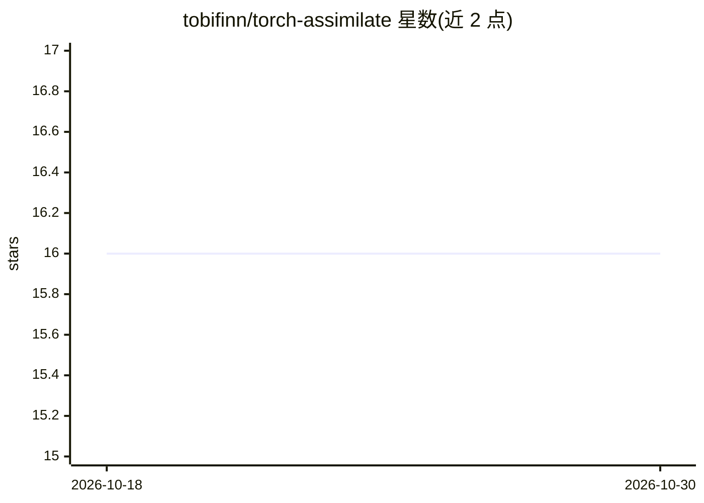

# tobifinn/torch-assimilate

⭐ 16 · Python · GPL-3.0 · 推送 2025-11-18 · [GitHub](https://github.com/tobifinn/torch-assimilate) · 个人维护

**气象数据同化的 PyTorch 库：并行优化同化算法处理模式与观测数据**

Python 数据同化包，将气象观测资料同化到数值天气模式数据中：同化方法以 PyTorch 实现优化，部分算法经 dask 并行化支持多核分布式计算，数据输入输出采用 xarray，设计面向基于 IO 操作的离线同化。为汉堡大学、波恩大学与马普气象研究所的非线性耦合数据同化博士课题开发。目前仅在 pypi-test 发布（正式 PyPI 与 conda 标记为不可用），PyTorch 需另行安装，未来计划加入集合卡尔曼滤波、粒子滤波、变分同化与神经同化等方法。

## 筛选速览

| 维度 | 判定 | 备注 |
|---|---|---|
| AI 角色 | `ai-native` | 本体是模型或模型工具 |
| 许可风险 | `viral` | GPL-3.0 |
| 部署形态 | `library` | 以包/库形式分发 |
| 模型依赖 | — | README 未给出锁定关系 |
| 硬件要求 | — | 无带数字的原话,不猜 |
| 安装摩擦 | `low` | 无编译、无系统依赖或容器化 |
| 成熟度 | — | 结构信号不足 |

## 能力要点

- 数据同化方法以 PyTorch 实现并优化
- 部分算法经 dask 并行化，支持多核分布式计算
- 基于 xarray 的数据输入输出
- 面向离线同化（IO 操作）设计

## 适用场景

- 将气象观测资料同化到数值天气模式输出中
- 在 GPU 上并行运行数据同化算法
- 科研中进行耦合数据同化方法实验

## 场景标签

`科研工具` · 领域:学习与行业

## 证据(README 行号)

> L44: torch-assimilate is a python package for data assimilation of meteorological
> L49: optimized in PyTorch [1]_. Furthermore, some

## 星数曲线

2026-10-18 16 → 2026-10-30 16（+0）

---
*卡片 v1 · prompt 1.4 · 生成 2026-10-30 · 置信度 mid · 依据 README sha `ba2d8f2a090e` · [字段定义](../../DATASET.md)*
