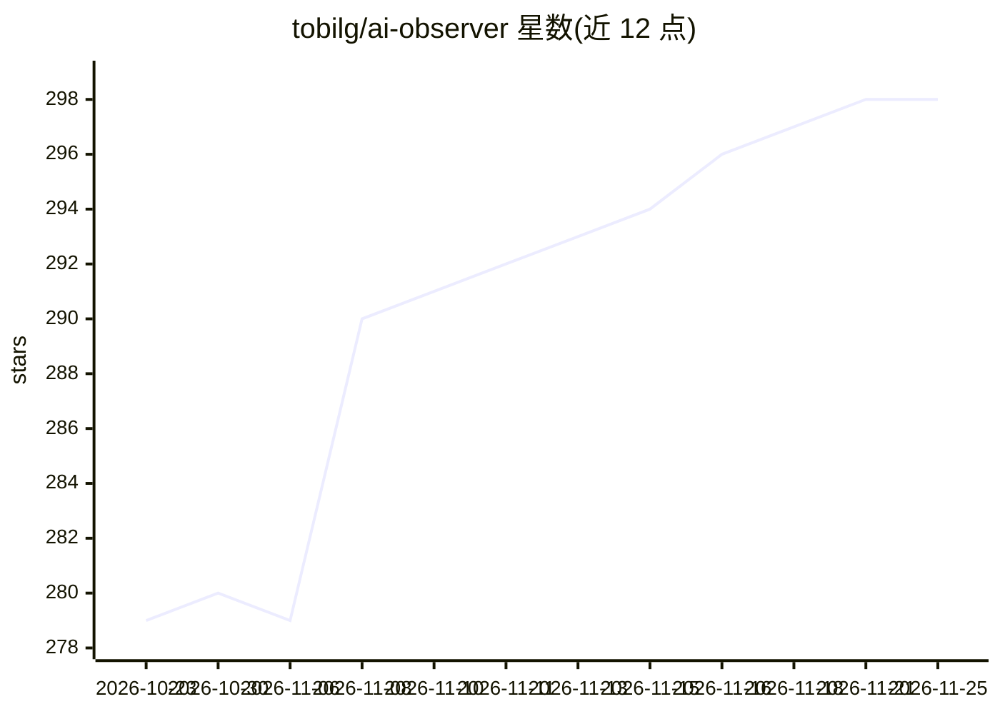

# tobilg/ai-observer

⭐ 298 · Go · MIT · 推送 2026-11-21 · [GitHub](https://github.com/tobilg/ai-observer) · 个人维护

**本地自托管的 AI 编码助手遥测观测后端**

单二进制、自托管的 OpenTelemetry 兼容观测后端，面向本地 AI 编码工具：通过 OTLP（HTTP/JSON、HTTP/Protobuf、gRPC）摄取或文件监听方式收集 Claude Code、Gemini CLI、Codex CLI、GitHub Copilot、OpenCode 的遥测数据，存储于内嵌 DuckDB，提供实时仪表盘、令牌用量与成本核算、日志/追踪查询、历史会话导入与 Parquet 导出、密钥脱敏、可选 MCP 端点供 agent 查询数据。默认仅监听 127.0.0.1，无内置认证时需注意网络暴露。

## 筛选速览

| 维度 | 判定 | 备注 |
|---|---|---|
| AI 角色 | `ai-ecosystem` | LLM/agent 周边工具 |
| 许可风险 | `permissive` | MIT |
| 部署形态 | `self-host` | docker 或自建部署 |
| 模型依赖 | — | README 未给出锁定关系 |
| 硬件要求 | — | 无带数字的原话,不猜 |
| 安装摩擦 | `low` | 无编译、无系统依赖或容器化 |
| 成熟度 | — | 结构信号不足 |

## 能力要点

- OTLP 原生摄取 + Claude/Codex/Gemini 会话文件实时监听与历史导入
- 内嵌 DuckDB 存储与定价数据，支持成本与延迟、错误率分析
- 单二进制（约 54MB，内嵌前端），提供多架构 Docker 镜像
- 内置脱敏（secrets/all/off）与可选 TLS、Token 认证

## 适用场景

- 本地集中查看多个 AI 编码助手的令牌用量与花费
- 排查 AI 工具的报错与慢响应到具体交互
- 把遥测数据保留在本地而非第三方服务

## 场景标签

`LLM 可观测性` · 领域:评测与运维

## 证据(README 行号)

> L3: > Unified local observability for AI coding assistants
> L5: **AI Observer** is a self-hosted, single-binary, OpenTelemetry-compatible observability backend designed specificall
> L29: - **OTLP-native** — Standard OpenTelemetry Protocol ingestion (HTTP/JSON, HTTP/Protobuf and gRPC)

## 星数曲线

2026-10-23 279 → 2026-11-25 298（+19）

---
*卡片 v1 · prompt 1.4 · 生成 2026-11-25 · 置信度 high · 依据 README sha `6a3d59e83881` · [字段定义](../../DATASET.md)*
