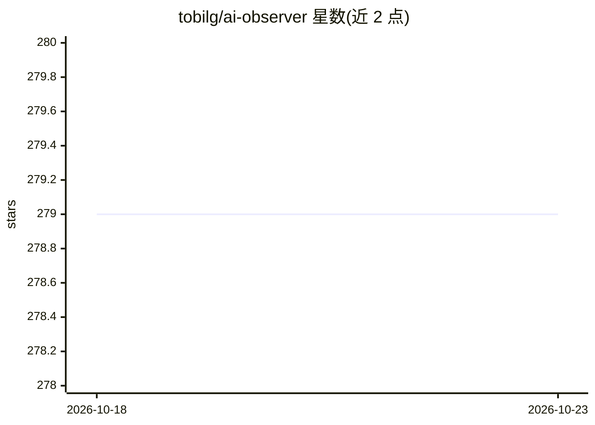

# tobilg/ai-observer

⭐ 279 · Go · MIT · 推送 2026-09-15 · [GitHub](https://github.com/tobilg/ai-observer) · 个人维护

**自托管单二进制的 AI 编程助手可观测性后端**

面向 Claude Code、Gemini CLI、OpenAI Codex CLI、GitHub Copilot、OpenCode 等本地 AI 编程工具的统一监控后端：通过标准 OTLP（HTTP/JSON 与 HTTP/Protobuf）摄取遥测，或用文件 watcher 直接读取各工具本地会话文件，跟踪 token 用量、成本、API 延迟、错误率与会话活动；数据存于 DuckDB，提供实时仪表盘、历史导入与 Parquet 导出，内嵌各模型定价数据用于成本计算。单二进制（约 54MB）或多架构 Docker 镜像部署，无外部依赖，数据本地保存。

## 筛选速览

| 维度 | 判定 | 备注 |
|---|---|---|
| AI 角色 | `ai-ecosystem` | LLM/agent 周边工具 |
| 许可风险 | `permissive` | MIT |
| 部署形态 | `self-host` | docker 或自建部署 |
| 模型依赖 | — | README 未给出锁定关系 |
| 硬件要求 | — | 无带数字的原话,不猜 |
| 安装摩擦 | `low` | 无编译、无系统依赖或容器化 |
| 成熟度 | — | 结构信号不足 |

## 能力要点

- OTLP 标准协议摄取 + 文件 watcher 两种数据接入方式
- DuckDB 存储支撑大数据量即时查询
- 内嵌 Claude/Codex/Gemini/Copilot 模型定价数据计算成本
- 单二进制部署、多架构 Docker 镜像、零外部依赖

## 适用场景

- 统一查看多个 AI 编程助手的 token 用量与花费
- 追踪 API 延迟与错误到具体会话交互
- 在本地保留遥测数据并导出 Parquet 归档

## 场景标签

 · 领域:开发者工具/可观测性

## 证据(README 行号)

> L5: **AI Observer** is a self-hosted, single-binary, OpenTelemetry-compatible observability backend designed specificall
> L7: Track token usage, costs, API latency, error rates, and session activity across all your AI coding assistants in one

## 星数曲线

2026-10-18 279 → 2026-10-23 279（+0）

---
*卡片 v1 · prompt 1.4 · 生成 2026-10-22 · 置信度 high · 依据 README sha `87fa66cf2c25` · [字段定义](../../DATASET.md)*
