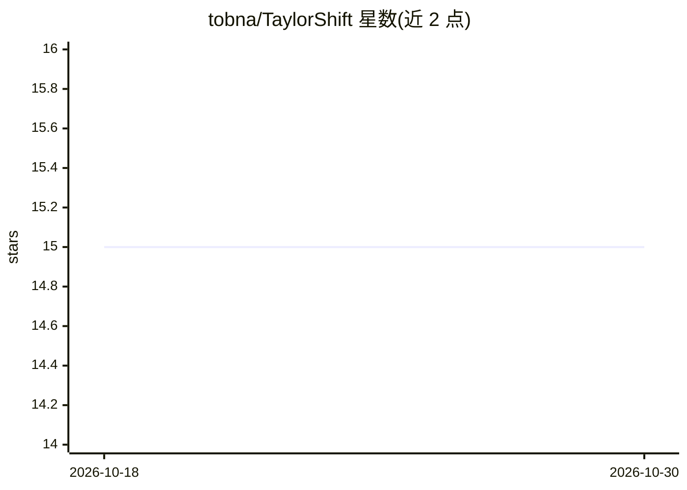

# tobna/TaylorShift

⭐ 15 · Python · MIT · 推送 2026-02-25 · [GitHub](https://github.com/tobna/TaylorShift) · [官网](https://tobias.nauen-it.de/publication/taylor-shift/) · 个人维护

**TaylorShift 论文代码：将自注意力复杂度由平方降至线性的注意力机制**

ICPR 2024 论文《TaylorShift》的代码附录，基于 PyTorch 的 Timm 包实现。提供带 TaylorShift 注意力机制的 Transformer 与 ViT 模型类，可通过阈值 N0 在 direct-TaylorShift（平方复杂度）与 efficient-TaylorShift（线性复杂度）实现间自动切换：序列长度超过 N0 时使用高效版本，否则使用直接版本。附带两种实现仅有数值差异的对比脚本与训练代码，供研究人员复现论文方法。实验与分析代码部分尚未完整收录。

## 筛选速览

| 维度 | 判定 | 备注 |
|---|---|---|
| AI 角色 | `ai-native` | 本体是模型或模型工具 |
| 许可风险 | `permissive` | MIT |
| 部署形态 | `None` |  |
| 模型依赖 | — | README 未给出锁定关系 |
| 硬件要求 | — | 无带数字的原话,不猜 |
| 安装摩擦 | `low` | 无编译、无系统依赖或容器化 |
| 成熟度 | — | 结构信号不足 |

## 能力要点

- 提供 TaylorShiftTransformer 与 TaylorShiftViT 模型类
- 通过阈值 N0 在平方与线性复杂度实现间自动切换
- 附带验证两种实现仅数值差异的对比脚本
- 基于 Timm/PyTorch 计算机视觉生态

## 适用场景

- 复现 ICPR 2024 论文中的 TaylorShift 注意力机制
- 在长序列任务中使用线性复杂度自注意力
- 研究注意力机制复杂度变化的数值行为

## 场景标签

 · 领域:深度学习/模型架构研究

## 证据(README 行号)

> L9: This is the code appendix for the paper *TaylorShift: Shifting the Complexity of Self-Attention from Squared to Line
> L25: You can instantiate a Transformer or ViT model with the TaylorShift attention mechanism by importing the correspond

## 星数曲线

2026-10-18 15 → 2026-10-30 15（+0）

---
*卡片 v1 · prompt 1.4 · 生成 2026-10-30 · 置信度 high · 依据 README sha `41a409fc95ec` · [字段定义](../../DATASET.md)*
