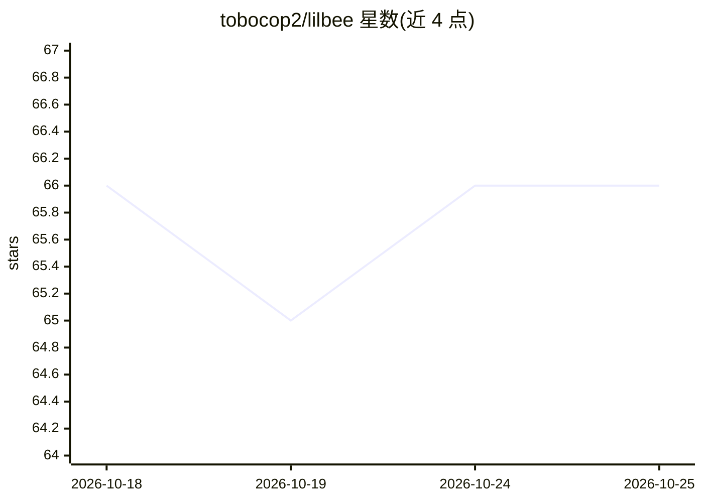

# tobocop2/lilbee

⭐ 66 · Python · MIT · 推送 2026-10-25 · [GitHub](https://github.com/tobocop2/lilbee) · [官网](https://lilbee.sh) · 个人维护

**单文件本地 AI 栈：运行本地模型并对文件/代码/网页做带引用的问答**

以单一可执行程序提供本地 AI 完整栈：基于 llama.cpp 的模型管理与多 GPU 调度（chat/embedding/vision/rerank），对本地文件、笔记、代码与抓取的网页建立索引，用户以自然语言提问并获得标注文件与行号的引用式回答。同时提供 MCP server 供 coding agent 接入、Web 爬虫入库、REST API、CLI、TUI、Python 库及 Obsidian 插件。声明处于 beta，接口与命令名可能在版本间变动；仅需云模型时才联网。

## 筛选速览

| 维度 | 判定 | 备注 |
|---|---|---|
| AI 角色 | `ai-native` | 本体是模型或模型工具 |
| 许可风险 | `permissive` | MIT |
| 部署形态 | `desktop` | 安装包/桌面程序 |
| 模型依赖 | local-ok | 支持本地模型 |
| 硬件要求 | — | 无带数字的原话,不猜 |
| 安装摩擦 | `low` | 无编译、无系统依赖或容器化 |
| 成熟度 | `idea` | |

## 能力要点

- 基于 llama.cpp 的内置模型管理与多 GPU（Metal/Vulkan/CUDA/ROCm）调度
- 答案引用精确到文件与行号的本地检索问答
- 提供 MCP server、REST API、CLI、TUI、Python 库与 Obsidian 插件多接入面
- 自带二进制携带 Python 运行时与 llama.cpp，无需外部模型服务器或容器

## 适用场景

- 对本地文件、笔记和代码做带引用来源的问答搜索
- 让 coding agent 通过 MCP 获取已索引内容的引用式回答
- 用单机方案运行和管理本地模型并保持数据不出本机

## 场景标签

`文档问答` `推理引擎` · 领域:知识与检索

## 证据(README 行号)

> L39: lilbee runs and manages your models: chat, embedding, vision, and rerank, placed across every GPU you have. It puts
> L47: Models are no different: lilbee has its own model manager and multi-GPU fleet, built on llama.cpp, so one executabl

## 星数曲线

2026-10-18 66 → 2026-10-25 66（+0）

---
*卡片 v1 · prompt 1.4 · 生成 2026-10-24 · 置信度 high · 依据 README sha `ac48fb83057c` · [字段定义](../../DATASET.md)*
