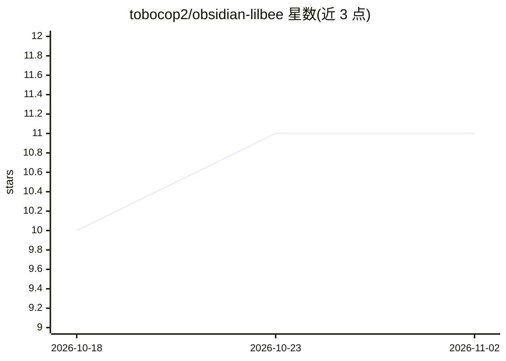

# tobocop2/obsidian-lilbee

⭐ 11 · TypeScript · MIT · 推送 2026-11-01 · [GitHub](https://github.com/tobocop2/obsidian-lilbee) · [官网](https://obsidian.lilbee.sh) · 个人维护

**把 Obsidian 仓库变成可对话的本地 RAG 搜索引擎的插件**

Obsidian 社区插件，在 Obsidian 内运行 lilbee 本地引擎：对整个 vault（笔记、PDF、电子书、代码等 150+ 语言文件）建立索引，用本地模型做检索增强生成并给出可点击溯源到源行的引用回答；内置网页爬虫把站点存为 markdown 笔记、可自动生成引用校验的 wiki、支持多 GPU 模型编排。默认自带模型目录一键下载运行，也可接入用户已有的 Ollama、LM Studio 或云模型；服务器、模型、索引均留在本机。面向 Obsidian 用户，从社区插件商店安装即可。

## 筛选速览

| 维度 | 判定 | 备注 |
|---|---|---|
| AI 角色 | `ai-native` | 本体是模型或模型工具 |
| 许可风险 | `permissive` | MIT |
| 部署形态 | `None` |  |
| 模型依赖 | local-ok | 支持本地模型 |
| 硬件要求 | — | 无带数字的原话,不猜 |
| 安装摩擦 | `medium` | 含编译或系统依赖之一 |
| 成熟度 | — | 结构信号不足 |

## 能力要点

- 对 vault 全文做 RAG，引用可点击溯源到源行并高亮
- 内置网页爬虫把站点存为 vault 中的 markdown 离线副本
- 模型目录从 Hugging Face Hub 一键下载并本地运行，多 GPU 分配
- 可接入已有 Ollama / LM Studio / 云模型作为后端

## 适用场景

- 在自己的笔记库里用自然语言提问并获得带引用的回答
- 把文档站点/维基爬取到 vault 离线检索与引用
- 从研究论文或公司维基自动生成引用校验的百科页面

## 场景标签

`文档问答` `知识库管理` `网页抓取` · 领域:效率与自动化

## 证据(README 行号)

> L9:  The whole local AI stack for your vault. It downloads the models, runs them, and turns your notes into a search eng
> L13: This plugin runs **lilbee** against your vault, inside Obsidian:
> L69: This plugin points lilbee at your vault. A local model then reasons over your library with retrieval-augmented gene

## 星数曲线

2026-10-18 10 → 2026-11-02 11（+1）

---
*卡片 v1 · prompt 1.4 · 生成 2026-11-01 · 置信度 high · 依据 README sha `007c3b4d1e59` · [字段定义](../../DATASET.md)*
