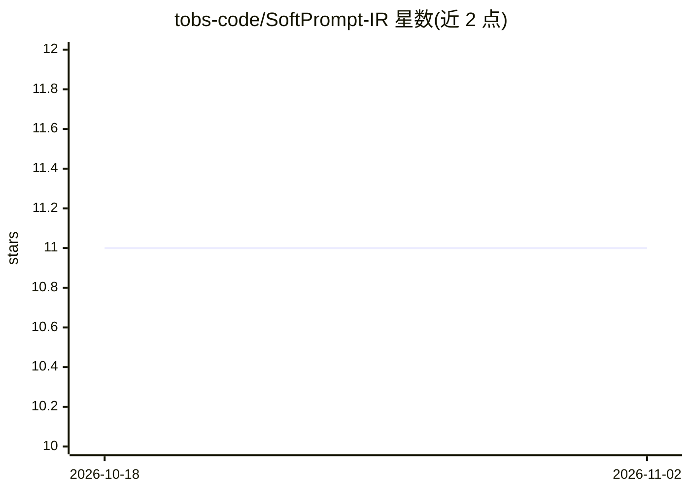

# tobs-code/SoftPrompt-IR

⭐ 11 · Apache-2.0 · 推送 2026-02-11 · [GitHub](https://github.com/tobs-code/SoftPrompt-IR) · 个人维护

**LLM 提示词的符号化意图标注规范：显式表达强度与方向**

一个实验性规范（非 DSL、非框架、无执行逻辑），用小型符号算子（如 !>>>、~<）在自然语言提示词内标注意图的强度、方向、优先级与支配关系，形成级联权重结构。不定义模型应做什么，只显式化"什么比什么更重要"。符号顺序固定为强度在前、方向在后，非正式语义依赖模型对训练中见过的规则/配置/优先级标记的结构识别能力。README 未提供安装命令、代码或运行方式，无强制与保证机制。

## 筛选速览

| 维度 | 判定 | 备注 |
|---|---|---|
| AI 角色 | `ai-knowledge` | 知识聚合/清单类 |
| 许可风险 | `permissive` | Apache-2.0 |
| 部署形态 | `None` |  |
| 模型依赖 | — | README 未给出锁定关系 |
| 硬件要求 | — | 无带数字的原话,不猜 |
| 安装摩擦 | `low` | 无编译、无系统依赖或容器化 |
| 成熟度 | `idea` | |

## 能力要点

- 以 [强度][方向] 形式的符号算子标注提示词中的意图权重
- 级联支配机制：更强标记支配更弱标记，冲突按权重而非语序解决
- 声明非正式语义，仅利用模型对一致结构的既有识别能力
- 自称可组合于任意提示词、兼容安全系统、不被支持时可忽略

## 适用场景

- 在长提示词中将隐式优先级显式化，降低歧义与意外矛盾
- 创作类任务中标注"避免/降级"类偏好的相对权重
- 对提示词中易被误加权的部分做局部结构化标注

## 场景标签

`提示工程` · 领域:Agent 开发

## 证据(README 行号)

> L7: SoftPrompt-IR is **not** a DSL, not a framework, and not a policy system.
> L9: It is a **minimal symbolic annotation layer** for explicitly expressing:
> L18: It defines **no execution logic**.

## 星数曲线

2026-10-18 11 → 2026-11-02 11（+0）

---
*卡片 v1 · prompt 1.4 · 生成 2026-11-01 · 置信度 mid · 依据 README sha `4ec436ba48fe` · [字段定义](../../DATASET.md)*
