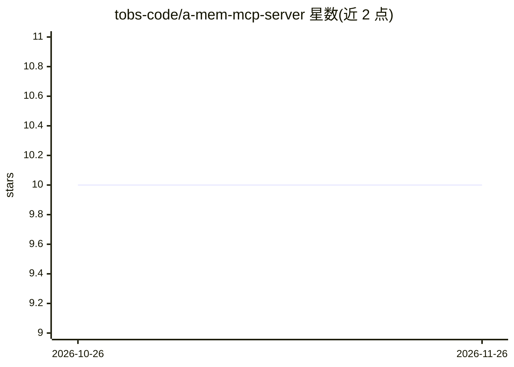

# tobs-code/a-mem-mcp-server

⭐ 10 · Python · NOASSERTION · 推送 2026-02-03 · [GitHub](https://github.com/tobs-code/a-mem-mcp-server) · 个人维护

**面向 IDE 的 LLM Agent 记忆系统 MCP 服务器**

基于 Zettelkasten 原理的 Agent 记忆系统，以 MCP 服务器形式集成到 Cursor、VSCode 等 IDE。采用双存储架构：ChromaDB 做向量相似检索，NetworkX/RustworkX/FalkorDB 做带类型边的显式图存储。自动抽取关键词、标签与摘要，生成记忆链接并动态演化；内置每小时后台运行的 19+ 项"记忆酶"维护操作（剪枝、去重、孤立节点连接、质量评分等），并提供低置信度检索触发的研究 Agent。

## 筛选速览

| 维度 | 判定 | 备注 |
|---|---|---|
| AI 角色 | `ai-ecosystem` | LLM/agent 周边工具 |
| 许可风险 | `none` | NOASSERTION |
| 部署形态 | `library` | 以包/库形式分发 |
| 模型依赖 | local-ok | 支持本地模型 |
| 硬件要求 | — | 无带数字的原话,不猜 |
| 安装摩擦 | `low` | 无编译、无系统依赖或容器化 |
| 成熟度 | — | 结构信号不足 |

## 能力要点

- ChromaDB + 图存储（NetworkX/RustworkX/FalkorDB 可选）的双存储架构
- 19+ 项后台记忆酶维护操作，每小时自动运行
- 笔记自动分类为 6 种类型并按类型/年龄/使用频次/连接数计算优先级
- 检索置信度低于阈值时自动触发的深度研究 Agent

## 适用场景

- 在 Cursor/VSCode 中为编码 Agent 提供持久化长期记忆
- 以知识图谱方式管理 agent 的笔记与语义关联
- 后台自动清理、去重与修复记忆图数据

## 场景标签

`Agent 记忆` `知识图谱` · 领域:Agent 开发

## 证据(README 行号)

> L48: This implementation focuses on **MCP Server integration** for IDE environments (Cursor, VSCode), providing:
> L49: - Direct IDE integration via MCP protocol
> L5: An agentic memory system for LLM agents based on the Zettelkasten principle.

## 星数曲线

2026-10-26 10 → 2026-11-26 10（+0）

---
*卡片 v1 · prompt 1.4 · 生成 2026-11-19 · 置信度 mid · 依据 README sha `3376dcb0b00e` · [字段定义](../../DATASET.md)*
