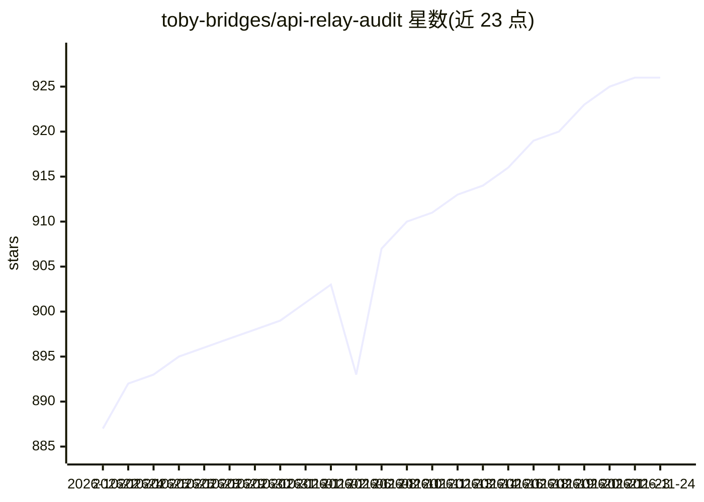

# toby-bridges/api-relay-audit

⭐ 929 · Python · AGPL-3.0 · 推送 2026-11-22 · [GitHub](https://github.com/toby-bridges/api-relay-audit) · [官网](https://apirelayaudit.com) · 个人维护 · 中文 README

**本地安全审计工具：检测 AI API 中转与 LLM 代理篡改行为**

针对第三方 AI API 中转、镜像、网关与 LLM 代理的本地安全审计脚本：通过 14 步探测覆盖提示注入、上下文截断、工具调用改写、模型替换信号、SSE 流异常、错误响应泄露与 Web3 钱包风险，生成分级（LOW/MEDIUM/HIGH）Markdown 或 JSON 报告。独立单文件脚本仅依赖 Python 标准库加 curl，API key 只发送到用户指定的中转 URL。同时以 DeepSeek Harness（DSH）插件形式分发，保留 OpenClaw 与 Hermes agent 技能文件。README 明确声明不认证中转安全、不替代人工审查。

## 筛选速览

| 维度 | 判定 | 备注 |
|---|---|---|
| AI 角色 | `ai-ecosystem` | LLM/agent 周边工具 |
| 许可风险 | `viral` | AGPL-3.0 |
| 部署形态 | `None` |  |
| 模型依赖 | — | README 未给出锁定关系 |
| 硬件要求 | — | 无带数字的原话,不猜 |
| 安装摩擦 | `low` | 无编译、无系统依赖或容器化 |
| 成熟度 | — | 结构信号不足 |

## 能力要点

- 14 步探测覆盖提示注入、模型替换、工具调用改写、SSE 异常与钱包风险
- 单文件零 Python 包依赖，API key 仅发送到用户指定 URL
- v2.5.0 支持 --format json 输出用于本地自动化
- 可安装为 DeepSeek Harness 插件，凭据经环境变量传递

## 适用场景

- 使用第三方 API 中转前检测是否存在提示注入或模型替换
- 在生产流量接入前对中转做可重复的本地安全检查
- 在 agent 触发钱包操作前检查中转的钱包相关行为
- 获取可审查的本地审计报告而非需提交 API key 的网页工具

## 场景标签

`网络安全` · 领域:学习与行业

## 证据(README 行号)

> L22: API Relay Audit is an independent, local security audit tool for AI API relays
> L73: - You use a third-party AI API relay, mirror, gateway, or LLM proxy.
> L119: The repository is also an installable `dsh-api-relay-audit` bundle for

## 星数曲线

2026-10-22 887 → 2026-11-24 926（+39）

---
*卡片 v1 · prompt 1.4 · 生成 2026-11-24 · 置信度 high · 依据 README sha `92435f5f5032` · [字段定义](../../DATASET.md)*
