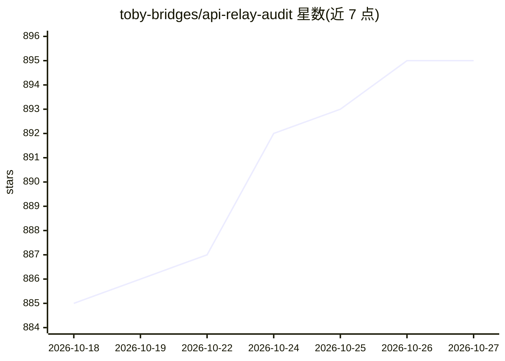

# toby-bridges/api-relay-audit

⭐ 895 · Python · AGPL-3.0 · 推送 2026-10-26 · [GitHub](https://github.com/toby-bridges/api-relay-audit) · [官网](https://apirelayaudit.com) · 个人维护 · 中文 README

**本地审计 AI API 中转/LLM 代理安全的工具，生成 Markdown 报告**

针对第三方 AI API 中转、镜像、网关与 LLM 代理的本地安全审计工具：通过 14 步探测检查隐藏提示注入、上下文截断、工具调用改写、SSE 流异常、错误响应泄露、模型替换信号与 Web3 钱包风险，输出带 LOW/MEDIUM/HIGH 分级的 Markdown 或 JSON 报告。面向在生产流量、编码代理自动化或钱包操作前评估中转行为的用户。独立脚本仅用 Python 标准库加 curl，API key 只发送到用户指定的中转 URL；另提供 DeepSeek Harness 插件分发。信号被视为线索而非替换证明，不签发安全证书。

## 筛选速览

| 维度 | 判定 | 备注 |
|---|---|---|
| AI 角色 | `ai-ecosystem` | LLM/agent 周边工具 |
| 许可风险 | `viral` | AGPL-3.0 |
| 部署形态 | `None` |  |
| 模型依赖 | locked-api |  |
| 硬件要求 | — | 无带数字的原话,不猜 |
| 安装摩擦 | `low` | 无编译、无系统依赖或容器化 |
| 成熟度 | — | 结构信号不足 |

## 能力要点

- 14 步探测：提示注入/上下文截断/工具改写/SSE 异常/模型替换信号
- general/web3/full 三种运行 profile，Web3 钱包安全检查按 profile 门控
- 零依赖独立脚本（标准库 + curl），支持 --format json 本地自动化
- DSH 插件分发复用 DSH 的 baseURL/凭据，凭据不进入命令参数与会话日志

## 适用场景

- 在生产流量前检查第三方 Claude/OpenAI 兼容中转是否注入或换模型
- Web3 agent 工作流签名/交易前审计钱包敏感的中转行为
- 以本地可重复报告替代索要 API key 的网页检测工具

## 场景标签

`网络安全` · 领域:学习与行业

## 证据(README 行号)

> L22: API Relay Audit is an independent, local security audit tool for AI API relays
> L23: and LLM proxies, informed by the paper. The current release checks observable
> L73: - You use a third-party AI API relay, mirror, gateway, or LLM proxy.

## 星数曲线

2026-10-18 885 → 2026-10-27 895（+10）

---
*卡片 v1 · prompt 1.4 · 生成 2026-10-21 · 置信度 high · 依据 README sha `08c73957d100` · [字段定义](../../DATASET.md)*
