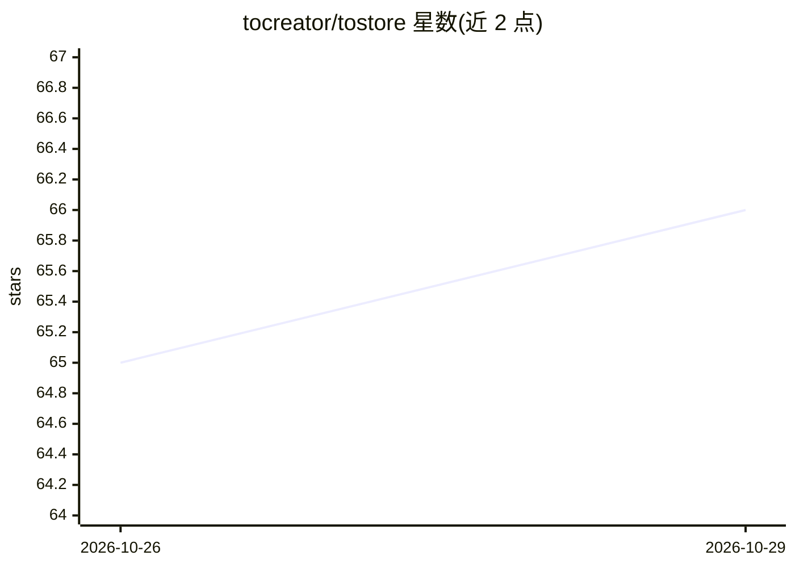

# tocreator/tostore

⭐ 66 · Dart · Apache-2.0 · 推送 2026-10-14 · [GitHub](https://github.com/tocreator/tostore) · [官网](https://pub.dev/packages/tostore) · 组织维护 · 中文 README

**面向边缘与 Agent 场景的分布式向量数据库/存储引擎（Dart/Flutter）**

ToStore 是用 Dart 编写的跨平台数据引擎，以 pub 包形式提供给 Flutter 移动端、桌面、Web 与服务器环境。统一支持关系型结构化数据、高维向量（vector 类型、向量索引与混合检索融合排序）与 KV、内存模式，内置 ACID 事务、JOIN、级联外键、表级 TTL、ChaCha20-Poly1305/AES-256-GCM 加密与多空间隔离；采用 Self-Routing 分布式架构，声明式 schema 变更与迁移由引擎在线自动完成，无需手写迁移脚本。另提供 llms-full.txt 供 AI 编码助手生成客户端代码时参考。

## 筛选速览

| 维度 | 判定 | 备注 |
|---|---|---|
| AI 角色 | `ai-ecosystem` | LLM/agent 周边工具 |
| 许可风险 | `permissive` | Apache-2.0 |
| 部署形态 | `None` |  |
| 模型依赖 | — | README 未给出锁定关系 |
| 硬件要求 | — | 无带数字的原话,不猜 |
| 安装摩擦 | `low` | 无编译、无系统依赖或容器化 |
| 成熟度 | — | 结构信号不足 |

## 能力要点

- 统一引擎覆盖关系数据、高维向量与 KV/内存模式
- 向量+结构化多路召回融合排序，带分数与通道诊断
- 声明式 schema 自动检测变更与迁移，无需版本脚本
- 内置加密、多空间隔离与自愈恢复

## 适用场景

- Flutter/多端应用本地持久化与向量语义检索
- Agent/边缘智能场景的边缘云协同数据底座
- 用内存模式+watch 替代全局变量做响应式状态管理

## 场景标签

`向量数据库` `Agent 记忆` · 领域:Agent 开发

## 证据(README 行号)

> L37: A unified data engine natively supporting relational structured data, high-dimensional vectors, and unstructured da
> L61:  - Multi-channel recall on one query chain (vector + structured and more)
> L177: |`vector`|`VectorData` / `List<num>`|High-dimensional vector data for AI semantic retrieval (embeddings)|

## 星数曲线

2026-10-26 65 → 2026-10-29 66（+1）

---
*卡片 v1 · prompt 1.4 · 生成 2026-10-25 · 置信度 high · 依据 README sha `e48bcb890516` · [字段定义](../../DATASET.md)*
