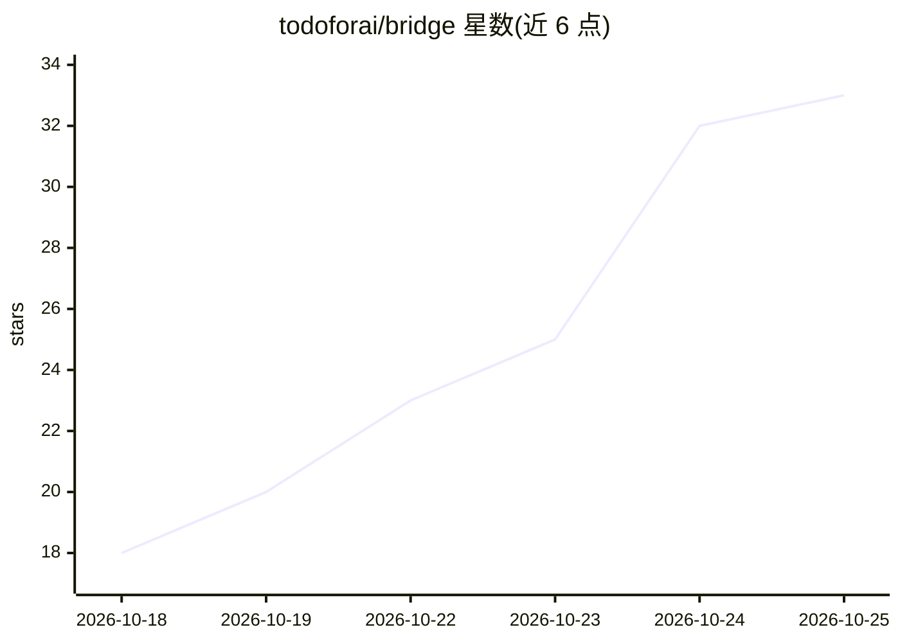

# todoforai/bridge

⭐ 34 · C · MIT · 推送 2026-10-25 · [GitHub](https://github.com/todoforai/bridge) · 组织维护

**C 编写的边缘桥接运行时：把用户机器与沙箱接入 TODOforAI 后端**

以单一 C 二进制实现的 bridge 运行时，通过 Noise_NX_25519_ChaChaPoly_BLAKE2b 加密的 WebSocket 通道将用户主机、Firecracker 沙箱和云 VM 连接到 TODOforAI 后端，经 PTY 执行 exec/output 等多会话命令。内置 shell 辅助工具：tfa-cat 让 AI agent 在终端向模型展示图片与 PDF、实时 tail 包装、adb 手机连接。支持设备策略（workspace 限制 + Linux Landlock 沙箱）、技能发现（.agents/.claude 的 SKILL.md）、systemd/launchd 监管下的自更新与可选的 keep-awake。需从源码 make 构建，依赖仅 libc/libutil。

## 筛选速览

| 维度 | 判定 | 备注 |
|---|---|---|
| AI 角色 | `ai-ecosystem` | LLM/agent 周边工具 |
| 许可风险 | `permissive` | MIT |
| 部署形态 | `desktop` | 安装包/桌面程序 |
| 模型依赖 | — | README 未给出锁定关系 |
| 硬件要求 | — | 无带数字的原话,不猜 |
| 安装摩擦 | `low` | 无编译、无系统依赖或容器化 |
| 成熟度 | — | 结构信号不足 |

## 能力要点

- Noise_NX 加密 WebSocket 通道，无需 TLS/OpenSSL，加密库 vendored
- tfa-cat：cat 替代品，让模型在 agent shell 中看到图片/PDF（PNG/JPEG/GIF/WebP/PDF）
- 设备策略：workspace 限制 + openat2 RESOLVE_BENEATH + Linux 6.2+ Landlock 沙箱
- 跨平台 POSIX + Windows（ConPTY，Win10 1809+），同一二进制运行

## 适用场景

- 让 TODOforAI 后端的 agent 在我的本机执行命令并回传结果
- 在 agent 的 shell 里直接把截图或 PDF 作为附件交给模型
- 限制后端只能访问指定 workspace 目录

## 场景标签

 · 领域:AI agent 基础设施/远程执行

## 证据(README 行号)

> L3: Native bridge runtime. Connects user machines, Firecracker sandboxes, and
> L15: Bridges are **islands by default.** One guaranteed capability: "accept
> L16: commands from the backend over WebSocket and execute them." Everything

## 星数曲线

2026-10-18 18 → 2026-10-25 33（+15）

---
*卡片 v1 · prompt 1.4 · 生成 2026-10-25 · 置信度 mid · 依据 README sha `cc3b1f7e3e63` · [字段定义](../../DATASET.md)*
