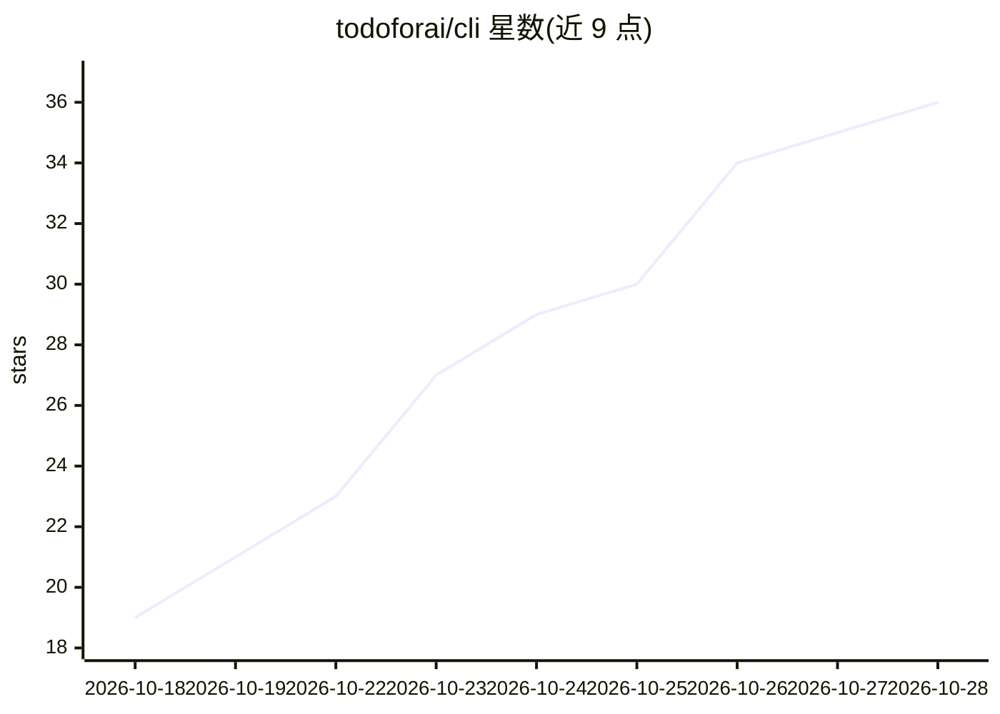

# todoforai/cli

⭐ 39 · TypeScript · MIT · 推送 2026-10-26 · [GitHub](https://github.com/todoforai/cli) · 组织维护

**在终端创建与管理 TODOforAI 任务的 CLI 客户端**

npm 安装的 Node.js 命令行工具，用于在终端创建、继续、检查 TODOforAI 的 AI agent 任务。CLI 通过 WebSocket 与后端通信，shell 执行、文件读写与工具调用发生在本地自动启动的 bridge 进程中，长任务在 CLI 退出后继续运行。支持从注册表模板创建任务、收件箱与成员通知（有每日条数上限）、以及通过 ACP 协议接入 Zed/JetBrains/VS Code 等编辑器驱动 agent。需 Node.js 20+，MIT 许可。

## 筛选速览

| 维度 | 判定 | 备注 |
|---|---|---|
| AI 角色 | `ai-ecosystem` | LLM/agent 周边工具 |
| 许可风险 | `permissive` | MIT |
| 部署形态 | `library` | 以包/库形式分发 |
| 模型依赖 | — | README 未给出锁定关系 |
| 硬件要求 | — | 无带数字的原话,不猜 |
| 安装摩擦 | `low` | 无编译、无系统依赖或容器化 |
| 成熟度 | — | 结构信号不足 |

## 能力要点

- 本地 bridge 进程承载 shell 执行、文件 I/O 与工具调用，任务可在 CLI 退出后继续运行
- 通过 ACP（stdio）集成 Zed、JetBrains、VS Code 等 ACP 客户端编辑器
- 支持注册表模板创建任务、stdin 管道输入与只读任务检查
- 按 API URL 隔离的项目/agent/状态配置，支持本地后端切换

## 适用场景

- 在终端以命令或管道方式创建并跟踪 AI agent 任务
- 让编辑器（Zed/JetBrains）通过 ACP 驱动 agent 在本机执行命令与编辑文件
- 通过 CLI 收取 agent 通知并向项目成员发送消息

## 场景标签

 · 领域:开发者工具/AI agent 客户端

## 证据(README 行号)

> L3: Create and manage TODOforAI tasks from your terminal.
> L28: The CLI talks to the backend over WebSocket; **shell execution, file I/O, and tool calls happen in the bridge** run
> L84: `tfa-cli acp` speaks the Agent Client Protocol over stdio, so any ACP-capable editor can drive your agent: prompts 

## 星数曲线

2026-10-18 19 → 2026-10-28 36（+17）

---
*卡片 v1 · prompt 1.4 · 生成 2026-10-25 · 置信度 high · 依据 README sha `9f5980117bde` · [字段定义](../../DATASET.md)*
