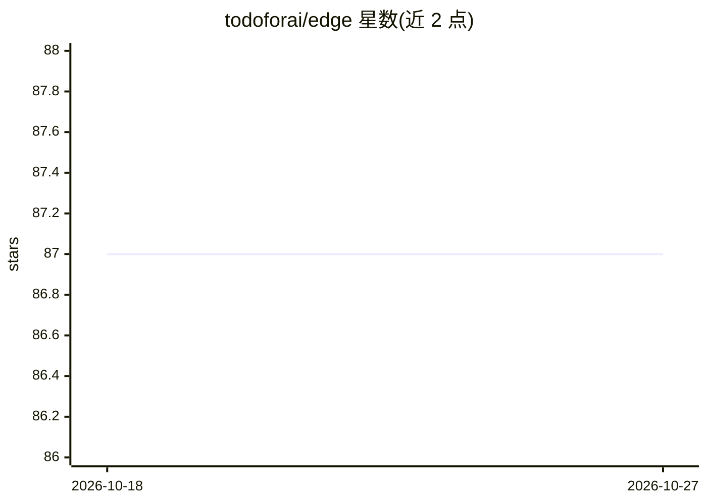

# todoforai/edge

⭐ 87 · TypeScript · NOASSERTION · 推送 2026-10-26 · [GitHub](https://github.com/todoforai/edge) · [官网](https://todofor.ai) · 组织维护

**把本机接入 TODO for AI 服务器的连接器，赋予 agent 本地操作能力**

TODO for AI 的 Web 连接器组件：在本机运行并连接 TODO for AI 服务器，使 agent 获得 shell 执行（流式输出与 PTY）、文件读写搜索（gitignore 感知）、DOCX/XLSX/PDF 编辑、git 感知的文件变更跟踪，以及通过浏览器扩展（CDP）驱动用户自己的 Chrome/Firefox 浏览器。支持自动配置 Python venv、Node 包与原生二进制，可按需安装 gh、rg 等 CLI 工具。首次运行走设备流登录，凭据存入系统凭据存储。提供 curl 脚本、npm 与源码（Bun）三种安装方式，预编译二进制覆盖 Windows/macOS/Linux。

## 筛选速览

| 维度 | 判定 | 备注 |
|---|---|---|
| AI 角色 | `ai-ecosystem` | LLM/agent 周边工具 |
| 许可风险 | `none` | NOASSERTION |
| 部署形态 | `library` | 以包/库形式分发 |
| 模型依赖 | — | README 未给出锁定关系 |
| 硬件要求 | — | 无带数字的原话,不猜 |
| 安装摩擦 | `low` | 无编译、无系统依赖或容器化 |
| 成熟度 | — | 结构信号不足 |

## 能力要点

- Shell 执行（流式输出、PTY 支持中断与 stdin）与文件系统操作
- DOCX/XLSX/PDF 读写编辑
- 通过 TODOforAI 扩展以 CDP 驱动用户自己的 Chrome/Firefox 浏览器
- 自动配置 Python venv/Node 包，按需安装 gh、rg、supabase 等 CLI 工具

## 适用场景

- 让 TODO for AI 的 agent 在本机执行命令与编辑文档
- 让 agent 操控我自己的浏览器完成任务
- 为 agent 提供本地文件系统与 git 感知的工作区访问

## 场景标签

`浏览器自动化` `Agent 框架` · 领域:Agent 开发

## 证据(README 行号)

> L3: The **Web connector** for TODO for AI — connects your machine to the TODO for AI server and gives TODOs shell, file,
> L52: - **Shell** — execute commands with streaming output and PTY (interrupt, stdin)

## 星数曲线

2026-10-18 87 → 2026-10-27 87（+0）

---
*卡片 v1 · prompt 1.4 · 生成 2026-10-24 · 置信度 high · 依据 README sha `d37a0d8b4382` · [字段定义](../../DATASET.md)*
