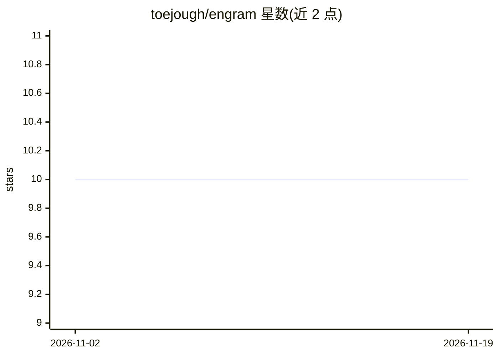

# toejough/engram

⭐ 10 · Go · Apache-2.0 · 推送 2026-10-24 · [GitHub](https://github.com/toejough/engram) · 个人维护

**为 LLM agent 提供自纠正持久记忆的 Claude Code 插件**

以 Go 编写的 CLI 与技能集，通过六个 SKILL.md 技能（recall/learn/please/route/curate/write-memory）为 Claude Code 和 Pi agent 提供基于 zettelkasten 式 Obsidian vault 的持久记忆：learn 将会话教训写入笔记并索引会话转录，recall 以相关性/探索/近因三通道检索笔记并评估覆盖度，please/route 做端到端编排与子代理派发，curate 判定待定笔记。存储层曾移除 TOML 记录格式、改为仅写 Obsidian vault，旧布局迁移未自动化。

## 筛选速览

| 维度 | 判定 | 备注 |
|---|---|---|
| AI 角色 | `ai-ecosystem` | LLM/agent 周边工具 |
| 许可风险 | `permissive` | Apache-2.0 |
| 部署形态 | `library` | 以包/库形式分发 |
| 模型依赖 | — | README 未给出锁定关系 |
| 硬件要求 | — | 无带数字的原话,不猜 |
| 安装摩擦 | `low` | 无编译、无系统依赖或容器化 |
| 成熟度 | — | 结构信号不足 |

## 能力要点

- 六个 SKILL.md 技能随 engram update 安装到 Claude Code 与 Pi
- 从会话转录自动索引与提取教训为 vault 笔记
- recall 检索按相关/探索/近因三通道并报告记忆是否改变了 agent 计划
- engram serve 提供只含固定子集端点的 HTTP 网络门，与本地 CLI 共享同一 vault 锁

## 适用场景

- 让 Claude Code 跨会话记住用户纠正与已验证做法
- 在 Obsidian 中以 wikilink 图谱查看 agent 记忆的聚类
- 多节点 vault 间通过 HTTP 接口查询与提交学习内容

## 场景标签

`Agent 记忆` · 领域:Agent 开发

## 证据(README 行号)

> L10: Engram gives Claude Code and Pi agents persistent memory via a zettelkasten-style vault. All six skills — `recall`,
> L12: `engram update` installs the skills into Claude Code and Pi, and the vault is harness-agnostic — so `recall` and `l
> L43:  On Claude Code, `engram update` also turns on automatic memory, the `engram-memory` mod: from the next session on,

## 星数曲线

2026-11-02 10 → 2026-11-19 10（+0）

---
*卡片 v1 · prompt 1.4 · 生成 2026-11-19 · 置信度 high · 依据 README sha `349fa5c2fabd` · [字段定义](../../DATASET.md)*
