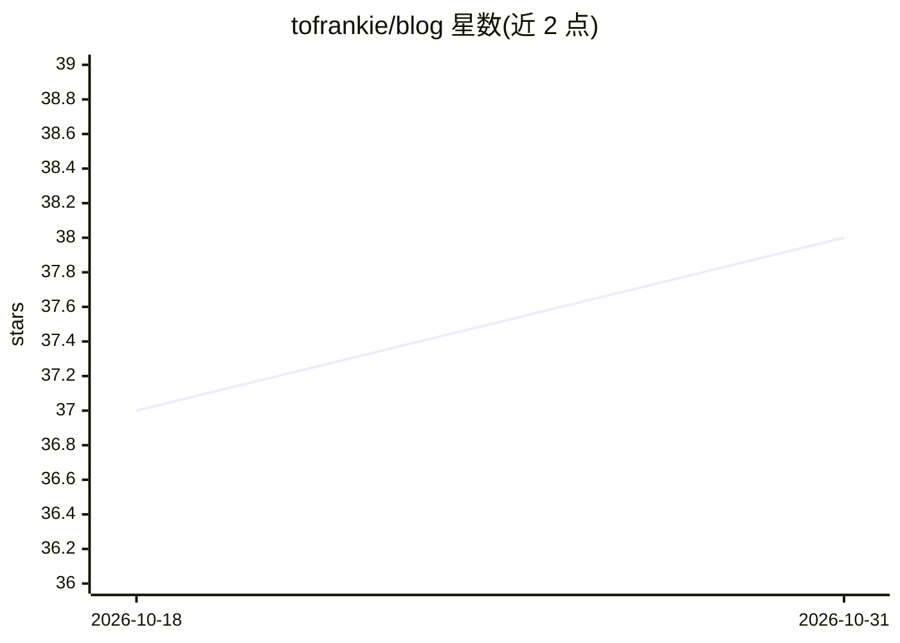

# tofrankie/blog

⭐ 38 · TypeScript · 推送 2026-10-30 · [GitHub](https://github.com/tofrankie/blog) · 个人维护 · 中文 README

**Frankie 的个人技术博客，收录 JavaScript 等精选文章清单**

个人博客仓库（GitHub Blogger 搭建），按年份（2017-2026）归档博文，并维护多个主题的精选文章清单：JavaScript 深入系列（原型、继承原理等）、提问方法、命名规范、中文技术写作规范及开发者路线图等外部资料链接。面向读者提供学习资源索引，支持 RSS 订阅。

## 筛选速览

| 维度 | 判定 | 备注 |
|---|---|---|
| AI 角色 | `ai-knowledge` | 知识聚合/清单类 |
| 许可风险 | `none` | — |
| 部署形态 | `None` |  |
| 模型依赖 | — | README 未给出锁定关系 |
| 硬件要求 | — | 无带数字的原话,不猜 |
| 安装摩擦 | `low` | 无编译、无系统依赖或容器化 |
| 成熟度 | — | 结构信号不足 |

## 能力要点

- 按年份归档 2017-2026 的博文
- JavaScript 深入学习资源精选清单
- 涵盖提问方法、命名规范、中文写作规范等主题的资料索引
- 提供 RSS 订阅

## 适用场景

- 查找 JavaScript 原型与继承等深入学习资料
- 参考中文技术写作与命名规范
- 按年份浏览作者博文归档

## 场景标签

`精选清单` · 领域:学习与行业

## 证据(README 行号)

> L15: **JavaScript 那些事**
> L41: - 為什麼你們就是不能加個空格呢？

## 星数曲线

2026-10-18 37 → 2026-10-31 38（+1）

---
*卡片 v1 · prompt 1.4 · 生成 2026-10-25 · 置信度 mid · 依据 README sha `3d076b2ca948` · [字段定义](../../DATASET.md)*
