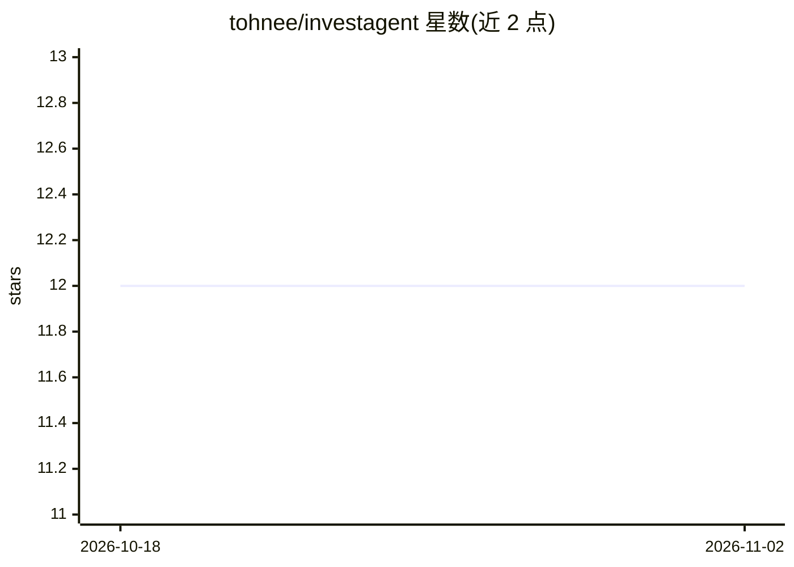

# tohnee/investagent

⭐ 12 · Python · MIT · 推送 2026-06-17 · [GitHub](https://github.com/tohnee/investagent) · 个人维护 · 中文 README

**面向个人投资者的多框架 AI 投研 Agent（A股/港股为主）**

Python 编写的开源投研 Agent，将五个开源研究框架（Serenity 产业链分析、Buffett 价值筛选、UZI-Skill 22 维深度分析、TradingAgents 多 Agent 决策、QuantDinger 量化回测）整合为按请求类型自动路由的流水线，输出含产业链拆解、估值筛选、多空论点与风险清单的结构化研报，报告末尾附免责声明。主要面向 A股/港股，美股与加密货币回测亦支持。设计为放入 .claude/skills/ 的 SKILL.md，由 Claude Code / Cursor / Codex 等 AI 编辑器原生调用；TradingAgents 与 QuantDinger 集成在 Roadmap 中标记为进行中。

## 筛选速览

| 维度 | 判定 | 备注 |
|---|---|---|
| AI 角色 | `ai-native` | 本体是模型或模型工具 |
| 许可风险 | `permissive` | MIT |
| 部署形态 | `self-host` | docker 或自建部署 |
| 模型依赖 | — | README 未给出锁定关系 |
| 硬件要求 | — | 无带数字的原话,不猜 |
| 安装摩擦 | `low` | 无编译、无系统依赖或容器化 |
| 成熟度 | — | 结构信号不足 |

## 能力要点

- 五个开源研究框架按查询类型自动路由编排
- SKILL.md 编排文件由 Claude Code / Cursor / Codex 原生加载，无需服务器
- 每交易日 08:00（Asia/Shanghai）定时自动研究并产出报告
- 设计原则规定数字均来自网络搜索/脚本/公开 API，拒绝编造数据

## 适用场景

- 让 AI 代理完成'研究A股AI半导体'式的主题产业链研究
- 用巴菲特八问框架对个股做价值筛选与深度分析
- 用多 Agent 辩论流程形成交易决策参考并用 QuantDinger 回测

## 场景标签

`金融量化` `多智能体` `科研工具` · 领域:Agent 开发

## 证据(README 行号)

> L14: **InvestAgent** is an open-source, AI-powered investment research agent that consolidates five proven research meth
> L18: When you ask InvestAgent to "研究A股AI半导体" or "深度分析贵州茅台", it orchestrates a six-stage pipeline:
> L87: Designed to be dropped into a `.claude/skills/` folder in your project. The `SKILL.md` orchestration file is consum

## 星数曲线

2026-10-18 12 → 2026-11-02 12（+0）

---
*卡片 v1 · prompt 1.4 · 生成 2026-10-31 · 置信度 mid · 依据 README sha `b1502fa4efa6` · [字段定义](../../DATASET.md)*
