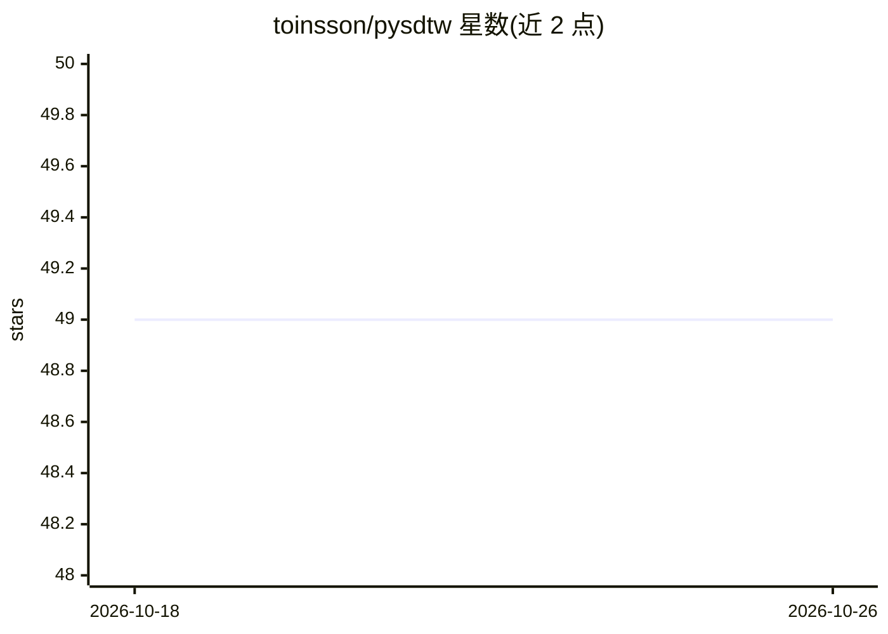

# toinsson/pysdtw

⭐ 49 · Python · MIT · 推送 2026-01-25 · [GitHub](https://github.com/toinsson/pysdtw) · 个人维护

**Soft-DTW 的 PyTorch 实现，支持 CPU 与 CUDA**

提供 Soft-DTW（可微动态时间规整）算法的 PyTorch 实现包，在 CPU 和 CUDA 硬件上运行，可计算两个批量张量间的 DTW 及其对输入的梯度。由早期 fork 项目演化为独立包，改进包括发布到 pypi、按包组织代码、带类型声明的 API、CUDA 上支持任意长度时间序列、支持 packed 序列以及修复 Sakoe-Chiba 带问题。依赖 pytorch 与 numba，通过 pip 安装，附测试套件与性能对比测量。

## 筛选速览

| 维度 | 判定 | 备注 |
|---|---|---|
| AI 角色 | `ai-native` | 本体是模型或模型工具 |
| 许可风险 | `permissive` | MIT |
| 部署形态 | `library` | 以包/库形式分发 |
| 模型依赖 | — | README 未给出锁定关系 |
| 硬件要求 | — | 无带数字的原话,不猜 |
| 安装摩擦 | `medium` | 含编译或系统依赖之一 |
| 成熟度 | — | 结构信号不足 |

## 能力要点

- CPU 与 CUDA 双支持，CUDA 上支持任意长度时间序列
- 可计算 DTW 及其对输入的梯度（可微）
- 支持 packed 序列与 Sakoe-Chiba 带
- 提供 pypi 包与测试套件（含性能对比）

## 适用场景

- 深度学习中以 Soft-DTW 作为可微损失函数
- 在 GPU 上对批量时间序列做 DTW 计算并求梯度
- 对比不同 Soft-DTW 实现的正确性与性能

## 场景标签

 · 领域:深度学习/时间序列

## 证据(README 行号)

> L3: Torch implementation of the Soft-DTW algorithm with support for both cpu and CUDA hardware.
> L23: Below is a small snippet showcasing the computation of the DTW between two batched tensors which also yields the gr

## 星数曲线

2026-10-18 49 → 2026-10-26 49（+0）

---
*卡片 v1 · prompt 1.4 · 生成 2026-10-25 · 置信度 high · 依据 README sha `be711c72029a` · [字段定义](../../DATASET.md)*
