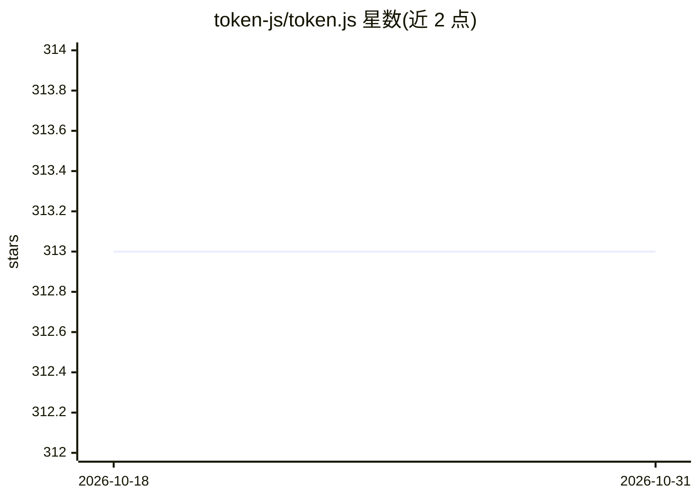

# token-js/token.js

⭐ 313 · TypeScript · MIT · 推送 2026-07-05 · [GitHub](https://github.com/token-js/token.js) · [官网](https://docs.tokenjs.ai/) · 组织维护

**TypeScript 统一 LLM SDK：以 OpenAI 格式调用 200+ 模型**

面向 TypeScript 开发者的 LLM 统一接入 SDK：使用 OpenAI 的消息格式即可调用 10+ 提供商（OpenAI、Anthropic、AWS Bedrock、Gemini、Groq 等）的 200+ 模型，客户端直接运行、无需代理服务器。支持流式输出、函数调用、JSON 输出与图像输入，各提供商的能力以兼容性表格列出；可通过 extendModelList 扩展预定义模型列表（如带区域前缀的 Bedrock 模型）。MIT 许可，npm 安装。

## 筛选速览

| 维度 | 判定 | 备注 |
|---|---|---|
| AI 角色 | `ai-ecosystem` | LLM/agent 周边工具 |
| 许可风险 | `permissive` | MIT |
| 部署形态 | `library` | 以包/库形式分发 |
| 模型依赖 | locked-api |  |
| 硬件要求 | — | 无带数字的原话,不猜 |
| 安装摩擦 | `low` | 无编译、无系统依赖或容器化 |
| 成熟度 | — | 结构信号不足 |

## 能力要点

- 以 OpenAI 格式统一调用 10+ 提供商的 200+ 模型
- 客户端运行，无需代理服务器
- 支持流式输出、函数调用、JSON 输出、图像输入
- extendModelList 可扩展预定义模型列表并声明特性支持

## 适用场景

- 不想为各 LLM 提供商分别写 SDK 适配代码的开发者
- 在应用中切换或并存多家 LLM 提供商
- 接入自定义或区域前缀的模型部署

## 场景标签

`模型网关` · 领域:Agent 开发

## 证据(README 行号)

> L3: Integrate 200+ LLMs with one TypeScript SDK using OpenAI's format. Free and open source. No proxy server required.
> L7: * Use OpenAI's format to call 200+ LLMs from 10+ providers.

## 星数曲线

2026-10-18 313 → 2026-10-31 313（+0）

---
*卡片 v1 · prompt 1.4 · 生成 2026-10-22 · 置信度 high · 依据 README sha `9604cb1eb8c5` · [字段定义](../../DATASET.md)*
